**2º DIA**

**EXAME NACIONAL DO ENSINO MÉDIO**

**PROVA DE CIÊNCIAS DA NATUREZA E SUAS TECNOLOGIAS**
**PROVA DE MATEMÁTICA E SUAS TECNOLOGIAS**

**enem2024**

**CADERNO**
**5**
**AMARELO**

**ATENÇÃO:** transcreva no espaço apropriado do seu CARTÃO-RESPOSTA, com sua caligrafia usual, considerando as letras maiúsculas e minúsculas, a seguinte frase:

**Todos têm um ideal. O meu é gostar de ler**

**LEIA ATENTAMENTE AS INSTRUÇÕES SEGUINTES:**

1. Este CADERNO DE QUESTÕES contém 90 questões numeradas de 91 a 180 e uma FOLHA DE RASCUNHO, dispostas da seguinte maneira:
a) questões de número 91 a 135, relativas à área de Ciências da Natureza e suas Tecnologias;
b) questões de número 136 a 180, relativas à área de Matemática e suas Tecnologias;
c) FOLHA DE RASCUNHO.

2. Confira se a quantidade e a ordem das questões do seu CADERNO DE QUESTÕES estão de acordo com as instruções anteriores. Caso o caderno esteja incompleto, tenha defeito ou apresente qualquer divergência, comunique ao aplicador da sala para que ele tome as providências cabíveis.

3. Para cada uma das questões objetivas, são apresentadas 5 opções. Apenas uma responde corretamente à questão.

4. O tempo disponível para estas provas é de **cinco horas**.

5. Reserve tempo suficiente para preencher o CARTÃO-RESPOSTA.

6. Os rascunhos e as marcações assinaladas no CADERNO DE QUESTÕES e na FOLHA DE RASCUNHO não serão considerados na avaliação.

7. Quando terminar as provas, acene para chamar o aplicador e entregue este CADERNO DE QUESTÕES, o CARTÃO-RESPOSTA e a FOLHA DE RASCUNHO.

8. Você poderá deixar o local de prova somente após decorridas duas horas do início da aplicação e poderá levar seu CADERNO DE QUESTÕES ao deixar em definitivo a sala de prova nos **30 minutos** que antecedem o término das provas.

# CIÊNCIAS DA NATUREZA E SUAS TECNOLOGIAS
**Questões de 91 a 135**

# QUESTÃO 91

O esquema representa um experimento feito com células do protozoário *Amoeba proteus*. Nele, um grupo de células foi tratado com a droga citocalasina B, enquanto outro grupo não foi tratado, servindo como controle. O formato e o movimento das células tratadas foram comprometidos.

>SADAVA, D. et al. **Vida: a ciência da biologia** — volume I: célula e hereditariedade. Porto Alegre: Artmed, 2009 (adaptado).

Qual componente celular foi afetado pela droga utilizada no experimento?

- **A** Vacúolos.
- **B** Mitocôndrias.
- **C** Microfilamentos.
- **D** Material genético.
- **E** Membrana plasmática.

# QUESTÃO 92

O magnésio metálico utilizado em ligas leves é produzido em um processo que envolve várias etapas e utiliza água do mar como matéria-prima. A primeira etapa desse processo consiste na reação entre o íon Mg²⁺ e o hidróxido de cálcio, Ca(OH)₂, obtendo uma mistura que contém hidróxido de magnésio, pouco solúvel, e íons Ca²⁺, de acordo com a equação química:

Mg²⁺ (aq) + Ca(OH)₂ (aq) → Mg(OH)₂ (s) + Ca²⁺ (aq)

O método adequado para separar o Mg(OH)₂ dessa mistura é a

- **A** filtração.
- **B** catação.
- **C** destilação.
- **D** dissolução.
- **E** evaporação.

# QUESTÃO 93

> Moradores do Brooklin, bairro de São Paulo, perdem o sono com um som alto, constante e estridente. O barulho é causado por anfíbios anuros trazidos do Caribe, da espécie *Eleutherodactylus johnstonei*, que têm tamanho um pouco maior que o de um grão de feijão e que encontraram na capital um ambiente favorável. Cientistas foram até o local e encontraram esses animais nos jardins das casas.
>
> **Pererecas-assobiadoras tiram o sono de moradores do Brooklin.** Disponível em: http://g1.globo.com. Acesso em: 26 mar. 2015 (adaptado).

Ao emitirem o som estridente, esses anfíbios

- **A** indicam que estão fora de seu hábitat natural.
- **B** alertam para a presença de poluição urbana.
- **C** sinalizam a existência de superpopulação.
- **D** direcionam insetos para sua alimentação.
- **E** atraem fêmeas para o acasalamento.

# QUESTÃO 94

A hidroxiapatita, Ca₅(PO₄)₃OH, é um mineral constituinte do esmalte dos dentes. Entre as diversas reações que ocorrem no meio bucal, encontram-se em equilíbrio as reações de desmineralização e mineralização da hidroxiapatita em meio aquoso, ilustradas a seguir. A desmineralização está associada à fragilização do esmalte do dente e à formação de cáries.

Ca₅(PO₄)₃OH (s) + H⁺ (aq) $\rightleftharpoons$ 5 Ca²⁺ (aq) + 3 PO₄³⁻ (aq) + H₂O (l)
*(Seta superior: Desmineralização; Seta inferior: Mineralização)* IMAGEM ERRADA -- Nao carregou

O uso de creme dental pode minimizar a perda da hidroxiapatita. O quadro apresenta o agente de polimento e o pH de alguns cremes dentais comerciais.

| Creme dental | Agente de polimento | pH |
| :---: | :--- | :---: |
| I | Bicarbonato de sódio | 9,5 |
| II | Carbonato de cálcio | 11,0 |
| III | Citrato de potássio | 7,7 |
| IV | Dióxido de silício | 6,9 |
| V | Fosfato de cálcio | 7,3 |

>STORGATTO, G. A.; BRAIBANTE, M. E. F.; BRAIBANTE, H. T. S. A química na odontologia. **Química Nova na Escola**, v. 39, fev. 2017 (adaptado).

Considerando o equilíbrio químico envolvido, qual creme dental promove a maior desmineralização do esmalte do dente?

- **A** I
- **B** II
- **C** III
- **D** IV
- **E** V

# QUESTÃO 95

A tirinha ilustra esquimós dentro de um iglu, habitação de formato hemisférico construída durante o inverno a partir de neve ou blocos de gelo. Essa estrutura de construção se justifica pelo fato de esse povo habitar as regiões mais setentrionais da Groenlândia, Canadá e Alasca.

>LAERTE. Disponível em: https://artedafisicapibid.blogspot.com. Acesso em: 4 dez. 2021 (adaptado).

Na tirinha, a geladeira é necessária para fazer gelo porque

- **A** a temperatura interna do iglu é maior que a de solidificação da água.
- **B** a umidade dentro do iglu dificulta o processo de mudança de fase da água.
- **C** o ar dentro do iglu é isolante térmico, dificultando a perda de calor pela água.
- **D** a temperatura uniforme no interior do iglu impede as correntes de convecção.
- **E** a pressão do ar no interior do iglu é baixa, dificultando a solidificação da água.

# QUESTÃO 96

Os pesticidas naturais vêm sendo utilizados no controle de pragas e doenças agrícolas como substitutos de pesticidas sintéticos tradicionais, por serem menos nocivos ao ambiente, biodegradáveis e minimizarem custos e riscos relativos à lavoura. Por exemplo, os compostos 1 e 2 estão envolvidos nas respostas de defesa das plantas. Os grupos funcionais presentes nesses compostos são importantes para suas propriedades no controle de pragas.

>   Pinto-Zevallos, D. M.; Zarbin, P. H. G. A química na agricultura: perspectivas para o desenvolvimento de tecnologias sustentáveis. **Química Nova**, n. 10, 2013 (adaptado).

Qual é a função orgânica correspondente ao grupo funcional comum presente nesses dois compostos?

- **A** Ácido carboxílico.
- **B** Cetona.
- **C** Alceno.
- **D** Álcool.
- **E** Fenol.

# QUESTÃO 97

Utilizando-se um mesmo meio nutritivo, três gêneros bacterianos diferentes foram submetidos ao cultivo em tubos de ensaio. Após certo período de crescimento da cultura bacteriana em condições físico-químicas ideais, observou-se que o padrão de distribuição das células (representadas por pontos na figura) ao longo dos tubos era diferente em cada um dos casos.

Em relação ao metabolismo energético, os microrganismos presentes nos tubos 1, 2 e 3 são classificados, respectivamente, como

- **A** anaeróbio facultativo, anaeróbio estrito e aeróbio estrito.
- **B** anaeróbio facultativo, aeróbio estrito e anaeróbio estrito.
- **C** aeróbio estrito, anaeróbio estrito e anaeróbio facultativo.
- **D** anaeróbio estrito, aeróbio estrito e anaeróbio facultativo.
- **E** aeróbio estrito, anaeróbio facultativo e anaeróbio estrito.

# QUESTÃO 98

>As placas que indicam saída de emergência brilham no escuro, pois apresentam substâncias que fosforecem na cor amarelo-esverdeada após exposição à luz ambiente, conforme a figura.
>
>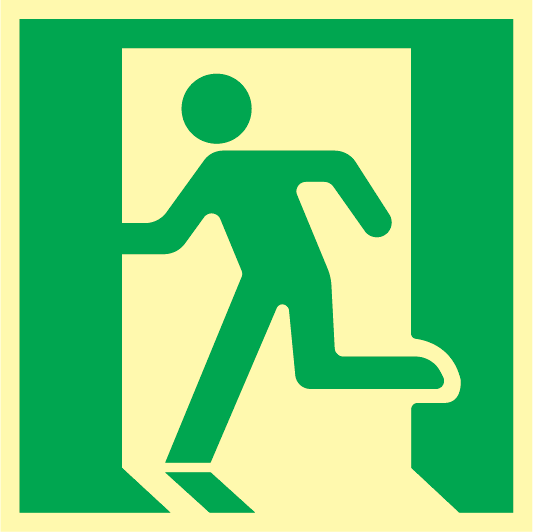
>
>Esse fenômeno ocorre pela presença do sulfeto de zinco (ZnS), dopado com prata ou cobre, na superfície da placa.
>
>**Zinc Sulphide Phosphorescence**. Disponível em: https://physicopenlab.org. Acesso em: 8 nov. 2023 (adaptado).

O aparecimento do brilho nessas condições ocorre como consequência de

- **A** colisões interatômicas.
- **B** coloração dos átomos.
- **C** transições eletrônicas.
- **D** reações nucleares.
- **E** reflexão da luz.

# QUESTÃO 99

>Indústrias farmacêuticas e instituições científicas têm trabalhado no desenvolvimento de diferentes vacinas contra a covid-19. Em algumas dessas vacinas, a principal estrutura antigênica é uma proteína de superfície viral chamada espícula (spike, em inglês). Essa proteína só existe em coronavírus, incluindo o SARS-CoV-2. Ela se liga a receptores de membrana específicos das células humanas por um mecanismo do tipo “chave-fechadura”. Dessa forma, os vírus entram nas células, podendo se multiplicar e acarretar a doença.
>
> **O que são vacinas?** Disponível em: www.cienciaviva.pt. Acesso em: 30 nov. 2021 (adaptado).

Nessas vacinas, essa proteína viral induz a

- **A** produção de anticorpos específicos contra os vírus.
- **B** imunidade passiva contra o desenvolvimento da doença.
- **C** alteração genômica para formação da memória imunológica.
- **D** neutralização direta dos vírus presentes na circulação sanguínea.
- **E** modificação dos receptores de membrana específicos para o vírus.

# QUESTÃO 100

Em um experimento de laboratório, duas barras metálicas, **A** e **B**, são carregadas com cargas opostas e imersas em óleo. Farelo de milho é jogado sobre o óleo e, após um certo tempo, o farelo assume o formato das linhas de campo elétrico entre as barras. A figura representa a vista superior desse experimento.

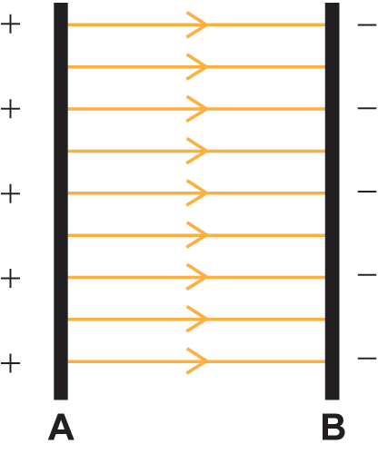

>ALMEIDA, M. A. T. **Introdução às ciências físicas 2** — volume 4: módulo 4. Rio de Janeiro: Fundação CECIERJ, 2007 (adaptado).

Ao repetir o experimento colocando um cilindro metálico oco entre as placas, o esquema que representa o formato das linhas de campo assumido pelo farelo é:

- **A** 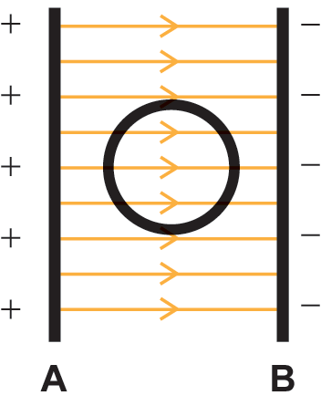
- **B** 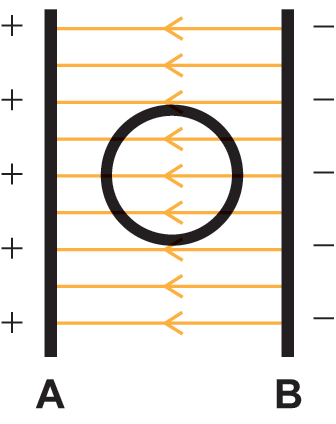
- **C** 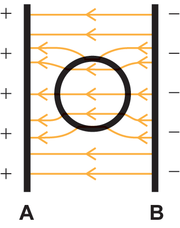
- **D** 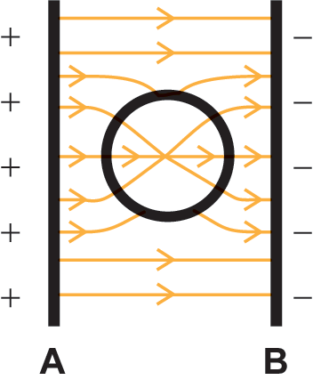
- **E** 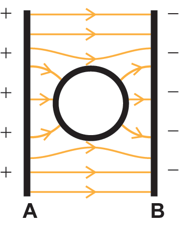

# QUESTÃO 101

Placas solares comuns dependem de dias ensolarados para gerar energia. Mas podemos gerar eletricidade com a ajuda de gotas de chuva, revestindo placas solares com uma fina camada de grafeno. Os íons dissociados a partir da água da chuva (Am+ e Bn−) tornam a combinação grafeno e água da chuva um par perfeito para geração de energia. O processo requer apenas uma camada de grafeno para que grande quantidade de elétrons (e−) se movimente ao longo da superfície.

>TANG, Q. et al. A Solar Cell that Is Triggered by Sun and Rain. **Angewandte Chemie International Edition**, n. 55, 2016 (adaptado).

Ao produzir eletricidade em dias chuvosos, o grafeno

- **A** oxida os cátions dissolvidos na água da chuva.
- **B** impede a difusão da água através das placas solares.
- **C** diminui a energia de ativação da reação no pseudocapacitor.
- **D** forma um compósito não metálico com os íons na água da chuva.
- **E** gera uma diferença de potencial pela interação dos elétrons com os cátions.

# QUESTÃO 102

Um estudante comprou uma cafeteira elétrica de 700 W de potência e com capacidade de 0,5 L de água (500 g). Enquanto o café estava em preparação na capacidade máxima da cafeteira, ele marcou que demorou 3 minutos para a cafeteira ferver toda a água (100 °C) a partir da temperatura ambiente de 20 °C. Em seguida, para avaliar a eficiência da cafeteira, ele calculou esse tempo desprezando quaisquer perdas energéticas. É necessária 1 cal (4,2 J) para elevar em 1 °C a temperatura de 1 grama de água.

Qual a eficiência energética calculada pelo estudante?

- **A** 100%
- **B** 75%
- **C** 60%
- **D** 7,5%
- **E** 5,1%

# QUESTÃO 103

O diagrama P-V a seguir representa o ciclo de Otto para um motor de combustão interna, como os motores a gasolina ou a etanol, utilizados nos automóveis.

As etapas representadas no diagrama estão descritas no quadro.

| Etapa | Processo | Descrição |
| :--- | :--- | :--- |
| I | 0 a 1 | Admissão isobárica da mistura ar-combustível no cilindro do motor. |
| II | 1 a 2 | Compressão adiabática da mistura. |
| III | 2 a 3 | Introdução de energia na forma de calor da combustão. |
| IV | 3 a 4 | Expansão adiabática. |
| V | 4 a 1 | Liberação de energia na forma de calor. |
| VI | 1 a 0 | Liberação dos gases resultantes da combustão. |

>Disponível em: www.mspc.eng.br. Acesso em: 24 fev. 2013 (adaptado).

A transformação da energia térmica em energia útil ocorre na etapa

- **A** II.
- **B** III.
- **C** IV.
- **D** V.
- **E** VI.

# QUESTÃO 104

Paras os circuitos de maratonas aquáticas realizadas em mares calmos e próximos à praia, é montado um sistema de boias que determinam o trajeto a ser seguido pelos nadadores. Uma das dificuldades desse tipo de circuito é compensar os efeitos da corrente marinha. O diagrama contém o circuito em que deve ser realizada uma volta no sentido anti-horário. As quatro boias estão numeradas de 1 a 4. Existe uma corrente marinha de velocidade $\vec{v}_c$, cujo módulo é 30 metros por minuto, paralela à praia em toda a área do circuito. Nas arestas mais longas, o nadador precisará nadar na direção apontada pelos vetores $\vec{v}_n$ dos pontos 1 até 2 e de 3 até 4. Considere que a velocidade do nadador é de 50 metros por minuto, em relação à água, durante todo o circuito.

![Diagrama de um circuito retangular com quatro boias numeradas de 1 a 4 nos vértices. A boia 1 está no vértice inferior esquerdo e a boia 2 no vértice inferior direito, separadas por uma linha tracejada. A boia 4 está no vértice superior esquerdo e a boia 3 no vértice superior direito, também separadas por uma linha tracejada. Uma seta indica a aresta superior com medida de 800 m e outra indica a aresta direita com medida de 400 m. No interior do circuito, uma seta $\vec{v}_n$ aponta na diagonal do ponto 1 para o ponto 2 e outra seta $\vec{v}_n$ aponta na diagonal do ponto 4 para o ponto 3. Uma seta vertical para baixo, identificada como $\vec{v}_c$, está posicionada próxima à aresta direita.](pg5img0_x0_90_y0_318_x1_455_y1_497.png)

Nessa situação, em quantos minutos o nadador completará a prova?

- **A** 42
- **B** 65
- **C** 72
- **D** 105
- **E** 120

# QUESTÃO 105

>O vírus linfotrópico de células T humanas tipo 1 (HTLV-1) é um retrovírus do mesmo grupo do vírus da imunodeficiência humana (HIV). Ambos são transmitidos da mesma forma e infectam as mesmas células de defesa do organismo, os linfócitos T. A diferença entre eles é que o HTLV-1 estimula o aumento da produção desses linfócitos, enquanto o HIV causa destruição dessas células.
>
>ROMANELLI, L. C. F.; CARAMELLI, P.; PROIETTI, A. B. F. C. O vírus linfotrópico de células T humanas tipo 1 (HTLV-1): quando suspeitar da infecção? **Revista da Associação Médica Brasileira**, v. 56, 2010 (adaptado).

Uma possível consequência da infecção por HTLV-1 é o desenvolvimento de

- **A** aids.
- **B** câncer.
- **C** diabetes.
- **D** hepatite B.
- **E** hemorragia.

# QUESTÃO 106

Na tirinha, Calvin se divertia em um balanço antes de soltar-se dele e cair ao chão. Em sua fala, ele demonstra ter imaginado que permaneceria em movimento circular. Porém, a força gravitacional, que permanece atuando no garoto, modifica a direção de sua velocidade, fazendo com que ele chegue ao chão da maneira ilustrada no último quadrinho.

>WATTERSON, B. Disponível em: https://tiras-do-calvin.tumblr.com. Acesso em: 19 nov. 2021 (adaptado).

Qual vetor representa a força resultante exercida pelo chão sobre Calvin no exato momento em que ele toca o chão?

- **A** 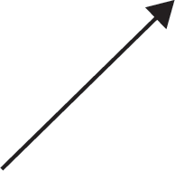
- **B** 
- **C** 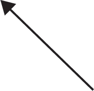
- **D** 
- **E** 

# QUESTÃO 107

>A fitorremediação é uma técnica que utiliza plantas para a remediação de ambientes contaminados. A descontaminação de solos pode ocorrer por descarte, absorção e metabolização, imobilização, extração ou volatilização do poluente, conforme representado na figura.
>
>![Ilustração esquemática de uma planta mostrando os processos de fitorremediação: à esquerda, a fitoextração é representada por raízes absorvendo partículas do solo; à direita, a fitovolatilização é mostrada por folhas liberando substâncias gasosas; abaixo, a fitoestabilização é indicada por raízes que imobilizam contaminantes no solo e a fitodegradação por raízes com microrganismos e setas de degradação. Ao lado direito, um quadro com definições textuais de fitoestabilização, fitovolatilização, fitodegradação, fitoestimulação e fitoextração.](pg6img0_x0_77_y0_157_x1_922_y1_506.jpeg)
>
>**Fitoestabilização:** imobilização dos contaminantes através de sorção por raízes, precipitação, complexação ou redução de valência.
>
>**Fitovolatilização:** retirada de poluentes pelas plantas e transferência para uma forma volátil.
>
>**Fitodegradação:** degradação dos contaminantes orgânicos por ação enzimática.
>
>**Fitoestimulação:** estimulação dos microrganismos degradadores de contaminantes orgânicos.
>
>**Fitoextração:** remoção de poluentes pelas raízes e sua transferência e acúmulo na parte aérea das plantas.
>
>LUIZ, E. P. **Avaliação dos métodos de fitorremediação [...] na remoção de chumbo, cobre e zinco**. São Paulo: UFABC, 2016 (adaptado).

O método que retira o mercúrio de uma área contaminada, impedindo sua entrada na cadeia alimentar, é a

- **A** fitoestabilização, ficando o mercúrio disponível sob a superfície das raízes das plantas.
- **B** fitovolatilização, permitindo a retirada do mercúrio por plantas e a sua transferência para uma forma volátil.
- **C** fitodegradação, com a degradação do mercúrio promovida por enzimas, contidas nas raízes, formando espécies menos tóxicas.
- **D** fitoestimulação, com a remoção do mercúrio pela ação de microrganismos presentes nas raízes que absorvem e imobilizam o metal.
- **E** fitoextração, em que as plantas que acumulam o mercúrio são cultivadas nesses locais, e a biomassa rica no metal é retirada após o crescimento.

# QUESTÃO 108

**Brasil fecha 2020 entre os maiores recicladores de latas de alumínio**

>A bauxita contém alumina (Al₂O₃), que é a matéria-prima para produção do alumínio (Al). De forma geral, são necessários 50 kg de bauxita para produzir 10 kg de alumínio. O Brasil fechou 2020 como um dos principais líderes mundiais em reciclagem de latas de alumínio. De acordo com levantamento da Associação Brasileira dos Fabricantes de Latas de Alumínio (Abralatas), o país obteve um índice de reciclagem de 97,4%, de um total de 4,0 × 10⁵ toneladas de latas vendidas. Considere que a lata é constituída de alumínio puro.
>
>Disponível em: https://agenciabrasil.ebc.com.br. Acesso em: 30 nov. 2021 (adaptado).

Levando em conta apenas a reciclagem de latas, qual é o valor mais próximo da massa de bauxita, em tonelada, que deixou de ser extraída da natureza em 2020 no Brasil?

- **A** 1,0 × 10⁴ ton
- **B** 3,9 × 10⁵ ton
- **C** 5,0 × 10⁵ ton
- **D** 1,9 × 10⁶ ton
- **E** 2,0 × 10⁷ ton

# QUESTÃO 109

O LED é um dispositivo eletrônico que conduz corrente elétrica em um único sentido, sendo caracterizado por uma tensão e uma corrente máxima de funcionamento, $I_{max}$. Um LED acende apenas se a corrente que o percorre estiver no sentido permitido e se a diferença de potencial a qual está submetido é igual ou superior à sua tensão de funcionamento. A figura ilustra o símbolo do LED usado na representação de circuitos.

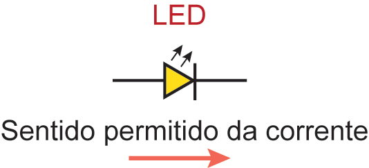

Um estudante de física analisa as propriedades do LED em um circuito simples de corrente contínua. Ele dispõe dos seguintes materiais: uma bateria ideal de 4,5 V; dois LEDs de tensão 3,0 V e $I_{max}$ = 1,0 mA cada; e dois resistores de 1,5 kΩ cada.

O circuito que o estudante pode montar, para que ambos os LEDs fiquem acesos e cada um seja percorrido por $I_{max}$ é

- **A** 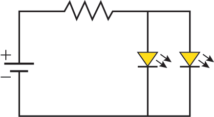
- **B** 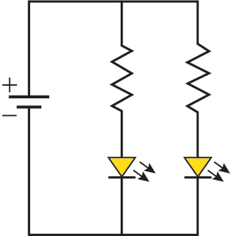
- **C** 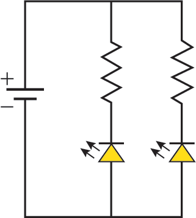
- **D** 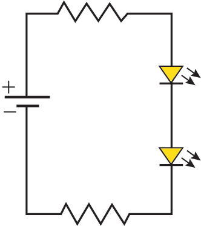
- **E** 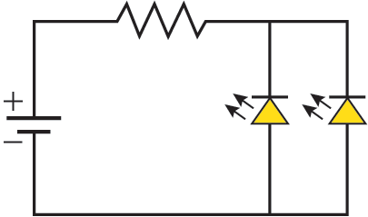

# QUESTÃO 110

Uma caixa decorativa utiliza duas pequenas lâmpadas, L₁ (6 V – 9 W) e L₂ (12 V – 18 W), ligadas em série a uma bateria de tensão $V_{QR}$. Um fio resistivo **QR**, de 48 centímetros, está ligado em paralelo à bateria. Cinco pontos, A, B, C, D e E, dividem o fio **QR** em seis segmentos de comprimentos iguais. O circuito também tem um amperímetro com dois terminais. Um dos terminais (P) está ligado ao fio entre as duas lâmpadas. O outro terminal (S) está livre e será ligado ao fio **QR**. Dependendo do ponto em que esse terminal livre for conectado, ocorrerá a mudança na tensão à qual as lâmpadas são submetidas. Os demais fios do circuito têm resistências elétricas desprezíveis. A figura ilustra esse circuito.

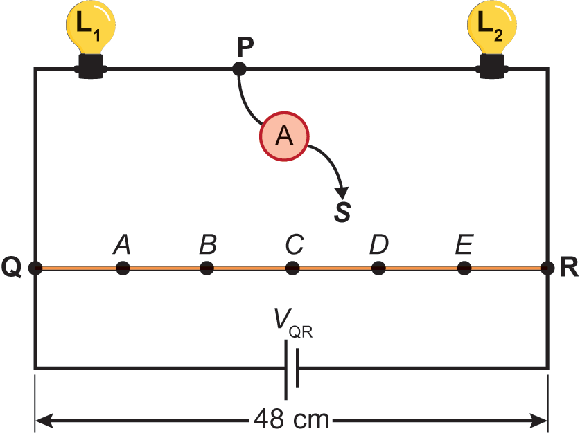

Em qual desses pontos o amperímetro deve ser conectado para que as lâmpadas acendam exatamente segundo as especificações de tensão e potência elétricas fornecidas?

- **A** A
- **B** B
- **C** C
- **D** D
- **E** E

# QUESTÃO 111

O biogás é uma alternativa energética muito importante, pois, além de reduzir a dependência por combustíveis fósseis, sua obtenção pode ser realizada a partir de resíduos da produção agroindustrial. Considere que o biogás produzido em um empreendimento de suinocultura contém 70% em volume de metano (massa molar 16 g/mol; volume molar 22 L/mol). Ele será utilizado para geração de energia em substituição ao etanol (massa molar 46 g/mol) em um gerador no qual 1 m³ de biogás de origem suína substitui 0,59 L de etanol anidro (densidade 0,78 g/mL).

Nessas condições, a massa de metano necessária para substituir 10 mol de etanol na produção de energia é mais próxima de

- **A** 300 g.
- **B** 400 g.
- **C** 510 g.
- **D** 590 g.
- **E** 720 g.

# QUESTÃO 112

A nimesulida é um fármaco pouco solúvel em água, utilizado como anti-inflamatório, analgésico e antitérmico. Essa substância pode ser convertida em uma espécie eletricamente carregada, de maior solubilidade em água, mediante o tratamento com uma base de Brønsted-Lowry, isto é, uma espécie química capaz de capturar um próton (H⁺). Na figura são apresentados os grupamentos presentes na estrutura química da nimesulida.

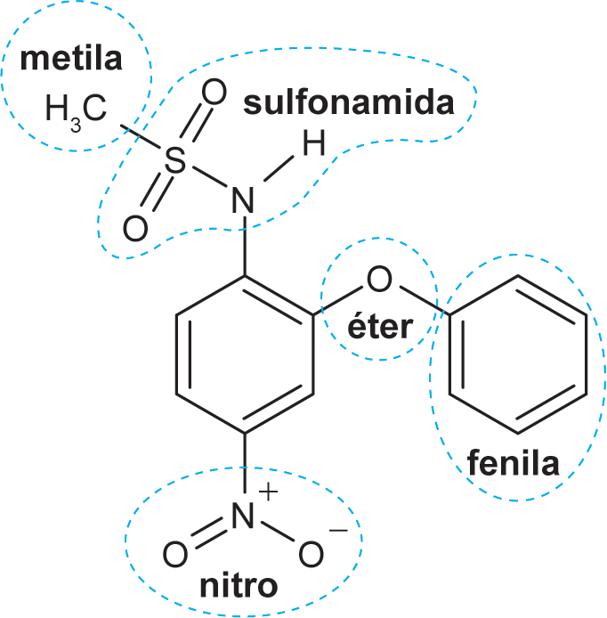

**Nimesulida**

>GONÇALVES, A. A. et al. Contextualizando reações ácido-base de acordo com a teoria protônica de Brønsted-Lowry usando comprimidos de propranolol e nimesulida. **Química Nova**, n. 3, 2013 (adaptado).

Na estrutura desse fármaco, o grupamento capaz de reagir com a base de Brønsted-Lowry é o grupo

- **A** sulfonamida.
- **B** metila.
- **C** fenila.
- **D** nitro.
- **E** éter.

# QUESTÃO 113

O desenvolvimento da biotecnologia e da clonagem gênica em procariotos fez com que a produção de proteínas se tornasse mais intensa, rápida e econômica. Para a produção de hormônios, enzimas e proteínas de resistência a drogas, uma variação da técnica de reação em cadeia pela polimerase (PCR, na sigla em inglês) utiliza a enzima transcriptase reversa (RT-PCR), que sintetiza moléculas de DNA complementares a partir de fitas de RNA.

Nesse contexto, essa técnica é importante para detectar genes

- **A** expressos.
- **B** plasmidiais.
- **C** bacterianos.
- **D** dominantes.
- **E** autossômicos.

# QUESTÃO 114

Nos automóveis, é importante garantir que o centro de massa (**CM**) de cada conjunto roda/pneu coincida com o seu centro geométrico. Esse processo é realizado em uma máquina de balanceamento, na qual o conjunto roda e pneu é colocado para girar a uma velocidade de valor constante. Com base nas oscilações medidas, a máquina indica a posição do centro de massa do conjunto, e pequenas peças de chumbo são fixadas em lugares específicos da roda até que as vibrações diminuam. Durante o treinamento de sua equipe, a fim de corrigir a posição do centro de massa indicada pela máquina, um mecânico apresenta o esquema a seguir, com cinco possíveis pontos da roda para posicionar uma peça de chumbo.

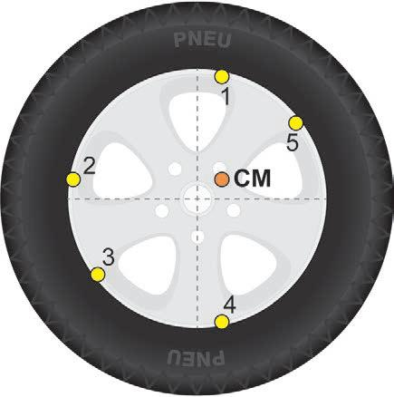

Em qual ponto deve ser fixada a peça de chumbo para corrigir a posição do centro de massa desse conjunto roda/pneu?

- **A** 1
- **B** 2
- **C** 3
- **D** 4
- **E** 5

# QUESTÃO 115

O soro caseiro serve para combater a desidratação por meio da reposição da água e sais minerais perdidos, por exemplo, por diarreia. Uma receita simples para a sua preparação consiste em utilizar duas colheres grandes (de sopa) de açúcar e duas colheres pequenas (de café) de sal de cozinha, dissolvidos em 2 L de água fervida, obtendo-se uma solução com concentração de íon sódio de 1,4 mg/mL.

Considere as massas molares: NaCl = 58,5 g/mol; Na = 23 g/mol.

Qual é o valor mais próximo da massa, em grama, de cloreto de sódio presente em uma única colher pequena?

- **A** 0,7 g
- **B** 1,8 g
- **C** 2,8 g
- **D** 3,6 g
- **E** 7,0 g

# QUESTÃO 116

Apesar de os animais representados no cladograma compartilharem um mesmo ancestral, eles se caracterizam por distintos padrões de reprodução ou de nutrição dos embriões e descendentes.

>DIXSON, A. F. **Mammalian Sexuality**: The Act of Mating and the Evolution of Reproduction. Disponível em: www.cambridge.org. Acesso em: 2 jul. 2024 (adaptado).

Ao longo do processo evolutivo, percebem-se, entre esses animais, perdas e ganhos nos padrões citados que envolvem o(a)

- **A** aumento no número de descendentes por ninhada.
- **B** mudança no tipo de fecundação de externa para interna.
- **C** redução da versatilidade de reprodução, que se torna unicamente sexuada.
- **D** desenvolvimento embrionário, que passa do meio aquático para o terrestre.
- **E** diminuição da vesícula vitelínica, associada ao desenvolvimento da lactação.

# QUESTÃO 117

Uma ambulância em alta velocidade com a sirene ligada desloca-se em direção a um radar operado por uma pessoa. O radar emite ondas de rádio com frequência $f_0$ que são refletidas pela dianteira da ambulância, retornando para o detector com frequência $f_r$. A percepção do operador do radar, em relação ao som emitido pela sirene, é de que este se altera à medida que a ambulância se aproxima ou se afasta.

Durante a aproximação, como o operador percebe o som da sirene e qual é a relação entre as frequências $f_r$ e $f_0$ medidas pelo radar?

- **A** Mais grave do que o som emitido e $f_r < f_0$.
- **B** Mais agudo do que o som emitido e $f_r < f_0$.
- **C** Mais agudo do que o som emitido e $f_r = f_0$.
- **D** Mais agudo do que o som emitido e $f_r > f_0$.
- **E** Mais grave do que o som emitido e $f_r > f_0$.

# QUESTÃO 118

**Mircoscópio 3D: produtor de ilusão instantânea**

O equipamento ilustrado na figura, de dimensões apresentadas no esquema, é composto por dois espelhos côncavos $E_1$ e $E_2$, apoiados um sobre o outro por suas bordas, de tal forma que o vértice de $E_1$ coincide com o foco de $E_2$ e vice-versa. Na abertura circular de $E_2$, é formada uma imagem tridimensional de um objeto posicionado sobre o vértice de $E_1$. Essa imagem é formada a partir dos raios procedentes do objeto, refletidos por $E_2$ e $E_1$, respectivamente, conforme o esquema. Os observadores julgam visualizar o objeto quando estão, de fato, visualizando sua imagem. O efeito só é possível porque as superfícies de ambos os espelhos são de extrema qualidade.

![Figura dividida em duas partes. Na parte superior, uma representação tridimensional de dois espelhos côncavos unidos pelas bordas, formando uma estrutura semelhante a uma tampa oval, com uma pequena figura de um cachorro sobre a abertura superior. Na parte inferior, um esquema bidimensional do corte transversal do equipamento, com a seguinte configuração: dois espelhos côncavos opostos, identificados como E1 (espelho inferior) e E2 (espelho superior). O esquema mostra um objeto (pequena figura de um cachorro) posicionado sobre o vértice de E1. Raios de luz partem do objeto, refletem em E2 e depois em E1, formando uma imagem. Estão indicadas as seguintes dimensões: a distância entre os vértices dos espelhos é de 5 cm; a altura total entre as bordas é de 3,8 cm na parte superior e 3,8 cm na parte inferior; a largura da abertura é de 23 cm.](pg9img1_x0_516_y0_339_x1_937_y1_659.jpeg)

>SALZMANN, W. Disponível em: https://wissenstexte.de. Acesso em: 27 jun. 2024 (adaptado).

A natureza da imagem formada e a distância vertical entre cada ponto objeto e seu correspondente ponto imagem são

- **A** real e 5 cm.
- **B** real e 3,8 cm.
- **C** real e 7,6 cm.
- **D** virtual e 7,6 cm.
- **E** virtual e 3,8 cm.

# QUESTÃO 119

>Muitas pessoas ainda se espantam com o fato de um passageiro sair ileso de um acidente de carro enquanto o veículo onde estava teve perda total. Essas pessoas talvez considerem, equivocadamente, que os carros mais seguros são os que têm as estruturas mais rígidas, ou seja, estruturas que, durante uma colisão, apresentam menor deformação. Na verdade, o que ocorre é o contrário. Por isso, a partir de 1958, passaram a ser produzidos carros com partes que se deformam facilmente.
>
>DAY, C. **Crumple Zones**. Disponível em: https://pubs.aip.org. Acesso em: 2 jul. 2024 (adaptado).

Assim, além dos cintos de segurança e dos airbags, os carros modernos passaram a contar com o dispositivo de segurança conhecido como *crumple zone* (região deformável), conforme a figura.

>**Momentum and Car safety**. GCSE Physics Revision. Disponível em: www.shalom-education.com. Acesso em: 5 jul. 2024 (adaptado).

Considerando o carro, seus ocupantes e o muro da figura como um sistema isolado, o *crumple zone* aumenta a segurança dos passageiros porque, durante uma colisão, a deformação da estrutura do carro

- **A** aciona os airbags do veículo.
- **B** absorve a energia cinética do sistema.
- **C** consome a quantidade de movimento do sistema.
- **D** cria uma barreira de proteção para seus ocupantes.
- **E** diminui a velocidade do centro de massa do sistema.

# QUESTÃO 120

Células a combustível microbianas (CCM) são capazes de gerar eletricidade a partir de águas residuárias urbanas e agroindustriais. As CCM são compostas de duas câmaras. Numa delas, ocorre o tratamento da matéria orgânica, as bactérias eletrogênicas crescem formando um biofilme e se alimentam dos poluentes presentes no efluente. Ao se alimentarem, essas bactérias geram uma corrente elétrica que percorre o material sobre o qual elas formaram o biofilme. Um fio condutor externo possibilita a migração dessa corrente para uma segunda câmara, promovendo uma reação química. A figura esquematiza uma CCM e as reações envolvidas.

![Esquema de uma célula a combustível microbiana (CCM). A figura mostra duas câmaras retangulares separadas por uma membrana central. Na câmara da esquerda (verde), há um ânodo (barra azul) e a entrada de matéria orgânica ($\text{CH}_3\text{COO}^-$), que é convertida em $\text{CO}_2$. Íons $\text{H}^+$ migram para a direita através da membrana. Na câmara da direita (azul), há um cátodo (barra laranja) onde o $\text{O}_2$ é convertido em $\text{H}_2\text{O}$. Elétrons ($\text{e}^-$) fluem do ânodo para o cátodo por um fio externo, no sentido indicado pelas setas.](pg10img1_x0_511_y0_272_x1_942_y1_444.png)

$\text{CH}_3\text{COO}^- \text{ (aq)} + 2 \text{H}_2\text{O (l)} \rightarrow 2 \text{CO}_2 \text{ (g)} + 7 \text{H}^+ \text{ (aq)} + 8 \text{e}^-$

$4 \text{H}^+ \text{ (aq)} + \text{O}_2 \text{ (g)} + 4 \text{e}^- \rightarrow 2 \text{H}_2\text{O (l)}$

>QUINTO, A. C. **Biotabaterias geram eletricidade a partir de esgoto sanitário e efluentes agroindustriais**. Disponível em: https://jornal.usp.br. Acesso em: 1 dez. 2021 (adaptado).

Qual das equações representa a reação global que ocorre durante o funcionamento dessa CCM?

- **A** $\text{CH}_3\text{COO}^- \text{ (aq)} + \text{O}_2 \text{ (g)} \rightarrow 2 \text{CO}_2 \text{ (g)} + 3 \text{H}^+ \text{ (aq)}$
- **B** $\text{CO}_2 \text{ (g)} + \text{O}_2 \text{ (g)} + \text{H}^+ \text{ (aq)} \rightarrow \text{H}_2\text{O (l)} + \text{CH}_3\text{COO}^- \text{ (aq)}$
- **C** $\text{CH}_3\text{COO}^- \text{ (aq)} + \text{H}^+ \text{ (aq)} + 2 \text{O}_2 \text{ (g)} \rightarrow 2 \text{CO}_2 \text{ (g)} + 2 \text{H}_2\text{O (l)}$
- **D** $\text{CH}_3\text{COO}^- \text{ (aq)} + 6 \text{H}_2\text{O (l)} \rightarrow 2 \text{CO}_2 \text{ (g)} + 2 \text{O}_2 \text{ (g)} + 15 \text{H}^+ \text{ (aq)}$
- **E** $2 \text{CO}_2 \text{ (g)} + 11 \text{H}^+ \text{ (aq)} + \text{O}_2 \text{ (g)} \rightarrow \text{CH}_3\text{COO}^- \text{ (aq)} + 4 \text{H}_2\text{O (l)}$

# QUESTÃO 121

No senso comum, considera-se, ainda hoje, que compostos orgânicos são substâncias presentes nos seres vivos. Na Química, a expressão “compostos orgânicos” tem um uso histórico de mais de 200 anos, adquirindo diferentes conotações ao longo do desenvolvimento dessa ciência. Atualmente, atribui-se a essa expressão outro significado.

A concepção científica atual define esses compostos como substâncias

- **A** benéficas à saúde humana.
- **B** capazes de serem biodegradadas.
- **C** formadas a partir de gás carbônico.
- **D** produzidas sem o uso de agrotóxicos.
- **E** contendo carbono como elemento principal.

# QUESTÃO 122

**Metabolismo de procariantes**

O esquema representa a ação de organismos no ciclo do nitrogênio e no ciclo do carbono. Os números correspondem a algumas etapas dos dois ciclos distintos.

**Procariantes no ciclo do nitrogênio**

![Diagrama do ciclo do nitrogênio e do carbono. No topo, sob fundo azul, a seta indica o Nitrogênio atmosférico (N2) entrando no sistema. À esquerda, o número 1 em um círculo amarelo aponta para o texto "Procariantes fixadores de nitrogênio: convertem N2 em amônia (NH3)", com uma seta para baixo até um círculo contendo bactérias. Em seguida, uma seta aponta para o texto "Procariantes nitrificantes: convertem NH3 em nitritos (NO2-) e nitratos (NO3-)", com uma seta para outro círculo de bactérias e, depois, para o número 2 em um círculo amarelo, que indica "Procariantes desnitrificantes: convertem nitratos em N2". Duas plantas são mostradas: uma com raízes expostas e nódulos, e outra com tomates. Abaixo, sob fundo azul, está o "Carbono atmosférico (CO2)" com uma seta para baixo. À esquerda, o número 3 em um círculo amarelo aponta para "Procariantes fotossintetizantes: fixam CO2", seguido por uma seta para um círculo de bactérias. Ao lado, o número 4 em um círculo amarelo indica "Plantas: fixam CO2", posicionado acima das mesmas duas plantas. Por fim, o número 5 em um círculo amarelo aponta para "Procariantes decompositores: convertem o carbono fixado em CO2", com uma seta para um último círculo de bactérias.](pg11img0_x0_11_y0_179_x1_527_y1_570.jpeg) IMAGEM ERRADA -- Falta uma imagem

>Disponível em: https://pt.khanacademy.org. Acesso em: 27 jun. 2024 (adaptado).

Em qual etapa numerada ocorre uma transformação redox como a que ocorre nos procariantes nitrificantes?

- **A** 1
- **B** 2
- **C** 3
- **D** 4
- **E** 5

# QUESTÃO 123

Um dos agentes que mais contribui para a poluição do ar é o automóvel a combustão interna. Em áreas urbanas, isso é demonstrado dramaticamente pela fumaça fotoquímica, resultante da interação entre óxidos de nitrogênio, hidrocarbonetos e luz solar, para formar produtos de oxidação, que causam irritação aos olhos, ao aparelho respiratório e danos às plantas. As condições de operação de motores a combustão, como a razão da mistura ar/combustível no cilindro, influenciam na composição dos gases lançados pelo escapamento na atmosfera. O gráfico ilustra a variação nas composições dos principais gases, dióxido de carbono (CO2), hidrocarbonetos (HC), monóxido de carbono (CO), monóxido de nitrogênio (NO) e oxigênio molecular (O2), emitidos por um motor a gasolina, em diferentes razões ar/combustível, em massa.

![Gráfico de linhas intitulado "Razão estequiométrica ar/combustível". O eixo horizontal representa a "Razão ar/combustível (massa/massa)", variando de 10 a 20, com uma seta central apontando para a direita, dividindo a área em "Deficiência" (à esquerda) e "Excesso" (à direita). O eixo vertical à esquerda representa "O2, CO2 (% volume)", variando de 0 a 14. O eixo vertical à direita representa "NO (10³ vpm), HC como C6 (10⁴ vpm)", variando de 0 a 7. Quatro curvas são mostradas: uma curva azul para CO2, que atinge um pico próximo a 15 no eixo horizontal; uma curva vermelha para HC, que decresce acentuadamente; uma curva verde para CO, que decresce; e uma curva laranja para NO, que atinge um pico próximo a 15. Uma linha vertical tracejada indica o valor 15 no eixo horizontal. Uma curva azul clara para O2 também é mostrada, crescendo a partir de 15.](pg11img2_x0_510_y0_471_x1_944_y1_778.png)

>RANGEL, M. C.; CARVALHO, M. F. A. Impacto dos catalisadores automotivos no controle da qualidade do ar. **Química Nova**, v. 26, 2003 (adaptado).

Na condição de razão ar/combustível igual a 18, haverá uma emissão

- **A** baixa de O2 e alta de NO.
- **B** baixa de NO e alta de HC.
- **C** baixa de CO e alta de CO2.
- **D** baixa de HC e alta de CO.
- **E** baixa de CO2 e alta de HC.

# QUESTÃO 124

**A saúde do professor: acústica arquitetônica**

Dentre os parâmetros acústicos que afetam a inteligibilidade dos sons emitidos em ambientes fechados, destacam-se o ruído de fundo do ambiente e o decréscimo do nível sonoro com a distância da fonte emissora. Assim, sentar-se no fundo da sala de aula pode prejudicar a aprendizagem dos estudantes, por impedir que eles distingam, com precisão, os sons emitidos, diminuindo a inteligibilidade da fala de seus professores. Considere a situação exemplificada pelo infográfico: à distância de 1 metro, o nível sonoro da fala de um professor é de 60 dB e diminui com a distância. Considere, ainda, que o ruído de fundo nessa sala de aula pode chegar a 45 dB e que, para ser compreendida, o nível sonoro da fala do professor deve estar 5 dB acima desse ruído.

>Disponível em: www.ufrj.br. Acesso em: 2 dez. 2021 (adaptado).

Para um valor máximo do ruído de fundo, a maior distância que um estudante pode estar do professor para que ainda consiga compreender sua fala é mais próxima de

- **A** 3,0 m.
- **B** 4,5 m.
- **C** 6,5 m.
- **D** 8,0 m.
- **E** 9,5 m.

# QUESTÃO 125

Uma agricultora, com a intenção de comercializar o milho recém-colhido, testou uma forma de preservar o sabor adocicado do seu produto. O melhor resultado foi obtido quando ela mergulhou as espigas em água fervente durante alguns minutos e, em seguida, em água gelada. Com esse procedimento, parte da glicose do milho não foi transformada em amido, mantendo o seu sabor adocicado.

Utilizando esse procedimento, o sabor foi conservado porque houve

- **A** desnaturação enzimática pela alta temperatura.
- **B** conversão de nutrientes pela redução de temperatura.
- **C** degradação das reservas nutritivas pelo choque térmico.
- **D** impedimento da entrada de oxigênio pela fervura da água.
- **E** desidratação dos grãos por causa da alteração da temperatura.

# QUESTÃO 126

Aquecedores solares são equipamentos utilizados para o aquecimento de água pelo calor do Sol. São compostos por coletores solares, nos quais ocorre o aquecimento da água, e por um reservatório térmico, em que é armazenada a água quente para ser utilizada posteriormente. A figura ilustra esquematicamente como funciona esse equipamento.

>**5 dicas de instalação de aquecedor solar.** Disponível em: https://instaline.com.br. Acesso em: 3 nov. 2023 (adaptado).

O processo pelo qual ocorre transferência de calor dos coletores solares para o reservatório térmico é a

- **A** difusão.
- **B** absorção.
- **C** condução.
- **D** irradiação.
- **E** convecção.

# QUESTÃO 127

As autoridades sanitárias brasileiras têm se preocupado muito nos últimos anos com o aumento da ocorrência de doenças transmitidas por mosquitos, principalmente arboviroses como chikungunya e zika, que se tornaram epidêmicas ou endêmicas em áreas urbanas. Parte de uma análise da relação entre a urbanização e a incidência dessas doenças está representada no fluxograma.

>ALMEIDA, L. S.; COTA, A. L. S.; RODRIGUES, D. F. Saneamento, arboviroses e determinantes ambientais: impactos na saúde urbana. **Ciência & Saúde Coletiva**, v. 25, n. 10, 2020 (adaptado).

Nesse contexto, como a urbanização está causando riscos à saúde humana?

- **A** Disseminando verminoses.
- **B** Causando a eutrofização de lagoas.
- **C** Aumentando a chance de contato com coliformes.
- **D** Diminuindo a população de predadores aquáticos.
- **E** Aproximando as pessoas das áreas de ocorrência de mosquitos.

# QUESTÃO 128

**Impactos do microplástico**

> A ação de fatores abióticos aliada à biodeterioração contribuem para a formação de microplásticos, os quais se aderem a outros poluentes orgânicos apolares persistentes, como os derivados de pesticidas lipossolúveis. Há uma proporcionalidade direta entre a solubilidade desses tipos de poluentes e sua concentração nos tecidos dos organismos expostos a eles.
>
> Disponível em: www.ecycle.com.br. Acesso em: 9 dez. 2021 (adaptado).

Em animais vertebrados, essa associação de poluentes será preferencialmente acumulada no tecido

- **A** ósseo.
- **B** nervoso.
- **C** epitelial.
- **D** adiposo.
- **E** sanguíneo.

# QUESTÃO 129

Em aeroportos, por razões de segurança, os passageiros devem ter suas bagagens de mão examinadas antes do embarque, passando-as em esteiras para sua inspeção por aparelhos de raios X. Nessas inspeções, os passageiros são orientados a retirar seus computadores portáteis (notebooks ou laptops) de malas, mochilas ou bolsas para passá-los isoladamente pela esteira.

Que explicação física justifica esse procedimento?

- **A** Os raios X não interagem com os componentes metálicos do computador, o que impede a formação de imagens.
- **B** Os raios X desmagnetizam o disco rígido do computador, quando refratados pelos componentes metálicos das bagagens de mão.
- **C** Os raios X aquecem os materiais metálicos encontrados em bagagens de mão, quando refletidos pelos componentes do computador.
- **D** Os raios X não atravessam os componentes densos do computador, o que impede a visualização de objetos que estão à frente ou atrás deles.
- **E** Os raios X ionizam os materiais metálicos normalmente encontrados em bagagens de mão, quando difratados pelos componentes do computador.

# QUESTÃO 130

Com base em testes realizados em ratos, concluiu-se que os compostos nitrosos são substâncias mutagênicas, ou seja, produzem mutações nas células e possivelmente câncer. Esses compostos podem ser obtidos pela reação entre o nitrito de sódio, que é um conservante adicionado às carnes, e o ácido clorídrico. O ácido nitroso produzido irá reagir com compostos nitrogenados, como as aminas, dando origem aos compostos nitrosos.

Em qual órgão esse processo será iniciado?

- **A** Rim.
- **B** Fígado.
- **C** Intestino.
- **D** Pâncreas.
- **E** Estômago.

# QUESTÃO 131

**Sistemas agroflorestais (SAFs)**

> Os sistemas agroflorestais alinham os interesses econômicos aos ecológicos. Esses sistemas podem ser usados na recuperação ambiental de áreas degradadas que se tornaram pouco produtivas, como as utilizadas por muito tempo para pastagem. Para isso, num primeiro momento, as árvores nativas são plantadas em conjunto com culturas agrícolas anuais, como feijão, mandioca, milho e abóbora, que geram renda para os proprietários da terra e incentivam a manutenção do sistema. Em um segundo momento, são introduzidas outras espécies, como trepadeiras e arbustos, de acordo com um arranjo espacial e temporal preestabelecido. Nesse processo, ocorrerão mudanças graduais na estrutura e composição das comunidades vegetais ao longo do tempo, que culminarão no aumento da diversidade do ambiente.
>
> Disponível em: www.embrapa.br. Acesso em: 9 dez. 2021 (adaptado).

O conjunto dessas mudanças graduais é análogo ao processo natural denominado

- **A** rotação de culturas.
- **B** sucessão ecológica.
- **C** coevolução específica.
- **D** adaptação por seleção.
- **E** convergência adaptativa.

# QUESTÃO 132

> As fibras musculares esqueléticas não são todas iguais. As fibras lentas, também conhecidas como fibras vermelhas, apresentam muitas mitocôndrias e são bem supridas por vasos sanguíneos. Já as fibras rápidas, ou fibras brancas, apresentam poucas mitocôndrias e recebem menor suprimento sanguíneo. Dessa forma, a distribuição das fibras nos músculos esqueléticos do corpo auxilia de forma diferenciada no desempenho físico de um atleta.
>
> SADAVA, D. et al. Vida: a ciência da biologia — volume III: plantas e animais. Porto Alegre: Artmed, 2009 (adaptado).

Um atleta que sonha em disputar os Jogos Olímpicos e tem uma maior proporção de fibras brancas que fibras vermelhas teria mais vantagens na realização da prova de:

- **A** Triatlo.
- **B** Salto em altura.
- **C** Marcha atlética.
- **D** Maratona aquática.
- **E** Ciclismo em estrada.

# QUESTÃO 133

>O Cerrado e a Amazônia abrigam grande número de serpentes popularmente conhecidas como cobras-corais. Na Amazônia predominam as corais-verdadeiras, que são peçonhentas, enquanto no Cerrado prevalecem as falsas-corais, que não possuem peçonha. Essas espécies apresentam um padrão de coloração muito semelhante. Essa similaridade traz uma vantagem tanto para as corais falsas como para as verdadeiras.
>
> FRANÇA, F. G. R. [...] serpentes corais em ambientes campestres, savânicos e florestais da América do Sul. Brasília: UnB, 2008 (adaptado).

Nas fotografias, são apresentados exemplos dessas serpentes: uma coral-verdadeira e uma falsa-coral.

>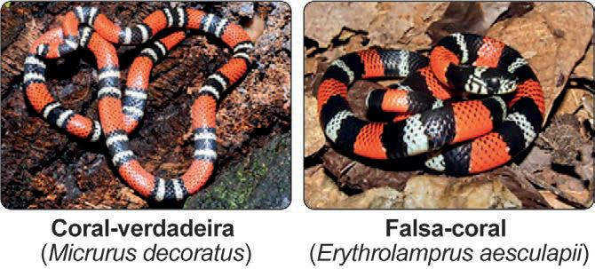
>
>**Coral-verdadeira**
>(Micrurus decoratus)
>
>**Falsa-coral**
>(Erythrolamprus aesculapii)
>
>SILVA, L. C.; COTTA, G. A.; RESENDE, F. C. Cobra-coral: aplicativo educativo para reconhecimento das cobras-corais do estado de Minas Gerais, Brasil. Herpetologia Brasileira, n. 1, 2021 (adaptado).

Qual é a vantagem dessa similaridade para as falsas-corais?

- **A** Facilita a captura de presas.
- **B** Diminui a competição por recursos.
- **C** Possibilita a geração de indivíduos híbridos.
- **D** Reduz a possibilidade de sofrerem predação.
- **E** Otimiza o encontro de parceiros reprodutivos.

# QUESTÃO 134

O exoesqueleto dos crustáceos é formado por quitina e impregnações de sais calcários e, por isso, é mais duro quando comparado com o exoesqueleto de outros artrópodes. Esse revestimento externo confere proteção, mas, por ser duro, limita o crescimento desses animais.

Para superar essa limitação, o exoesqueleto deve ser

- **A** formado somente na fase adulta do animal.
- **B** fragmentado para expansão nas áreas de articulação.
- **C** modelado continuamente para ajuste ao tamanho do corpo.
- **D** substituído por meio de mudas que ocorrem periodicamente.
- **E** impregnado por pequena quantidade de sais para sua distensão.

# QUESTÃO 135

Um dos exemplos mais conhecidos de herança recessiva ligada ao cromossomo X é o daltonismo. Como em qualquer distúrbio recessivo ligado ao cromossomo X, existem muito mais homens apresentando o fenótipo com esse tipo de daltonismo do que mulheres. Um casal formado por um homem não daltônico e por uma mulher gestante também não daltônica, mas portadora do gene recessivo para esse tipo de daltonismo, está esperando um bebê. Em uma das consultas de pré-natal, o casal recebeu um heredograma que contém todas as possibilidades de genótipo para esse bebê.

Considere a legenda:

>
>IMAGEM ERRADA
>
>- Mulher heterozigota portadora do gene para daltonismo
>- Mulher não daltônica
>- Mulher daltônica
>- Homem não daltônico
>- Homem daltônico
>
>GRIFFITHS, A. et al. Introdução à genética. Rio de Janeiro: Guanabara Koogan, 2016 (adaptado).

Qual heredograma foi recebido pelo casal?

- **A** [Heredograma com casal em que a mulher é heterozigota portadora e o homem é não daltônico, com três descendentes: uma mulher não daltônica, uma mulher daltônica e um homem daltônico.] IMAGEM ERRADA - FALTANDO
- **B** [Heredograma com casal em que a mulher é heterozigota portadora e o homem é não daltônico, com três descendentes: uma mulher não daltônica, uma mulher heterozigota portadora e um homem daltônico.] IMAGEM ERRADA - FALTANDO
- **C** [Heredograma com casal em que a mulher é heterozigota portadora e o homem é não daltônico, com três descendentes: uma mulher heterozigota portadora, uma mulher heterozigota portadora e um homem não daltônico.] IMAGEM ERRADA - FALTANDO
- **D** [Heredograma com casal em que a mulher é heterozigota portadora e o homem é não daltônico, com três descendentes: uma mulher não daltônica, uma mulher não daltônica e um homem daltônico.] IMAGEM ERRADA - FALTANDO
- **E** [Heredograma com casal em que a mulher é heterozigota portadora e o homem é não daltônico, com três descendentes: uma mulher daltônica, uma mulher daltônica e um homem não daltônico.] IMAGEM ERRADA - FALTANDO

---

# MATEMÁTICA E SUAS TECNOLOGIAS
## Questões de 136 a 180

# QUESTÃO 136

Uma empresa produz mochilas escolares sob encomenda. Essa empresa tem um custo total de produção, composto por um custo fixo, que não depende do número de mochilas, mais um custo variável, que é proporcional ao número de mochilas produzidas. O custo total cresce de forma linear, e a tabela apresenta esse custo para três quantidades de mochilas produzidas.

| Quantidade de mochilas | 30 | 50 | 100 |
| :--- | :--- | :--- | :--- |
| **Custo total (R$)** | 1 050,00 | 1 650,00 | 3 150,00 |

O custo total, em real, para a produção de 80 mochilas será

- **A** 2400,00.
- **B** 2520,00.
- **C** 2550,00.
- **D** 2700,00.
- **E** 2800,00.

# QUESTÃO 137

A umidade relativa do ar é um dos indicadores utilizados na meteorologia para fazer previsões sobre o clima. O quadro apresenta as médias mensais, em porcentagem, da umidade relativa do ar em um período de seis meses consecutivos em uma cidade.

| Meses | Maio | Jun. | Jul. | Ago. | Set. | Out. |
| :--- | :--- | :--- | :--- | :--- | :--- | :--- |
| **Média mensal da umidade relativa do ar (%)** | 66 | 64 | 54 | 46 | 60 | 64 |

Nessa cidade, a mediana desses dados, em porcentagem, da umidade relativa do ar no período considerado foi

- **A** 56.
- **B** 58.
- **C** 59.
- **D** 60.
- **E** 62.

# QUESTÃO 138

Uma empresa de engenharia foi contratada para realizar um serviço no valor de R$ 71 250,00. Os sócios da empresa decidiram que 40% desse valor seria destinado ao pagamento de três engenheiros que gerenciaram o serviço. O pagamento para cada um deles será feito de forma diretamente proporcional ao total de horas trabalhadas. O número de dias e o número de horas diárias trabalhadas pelos engenheiros foram, respectivamente:

- engenheiro I: 4 dias, numa jornada de 5 horas e meia por dia;
- engenheiro II: 5 dias, numa jornada de 4 horas por dia;
- engenheiro III: 6 dias, numa jornada de 2 horas e meia por dia.

Qual a maior diferença, em real, entre os valores recebidos por esse serviço entre dois desses engenheiros?

- **A** 1000
- **B** 1500
- **C** 3500
- **D** 3800
- **E** 5250

# QUESTÃO 139

Um hospital tem 7 médicos cardiologistas e 6 médicos neurologistas em seu quadro de funcionários. Para executar determinada atividade, a direção desse hospital formará uma equipe com 5 médicos, sendo, pelo menos, 3 cardiologistas.

A expressão numérica que representa o número máximo de maneiras distintas de formar essa equipe é

- **A** $\frac{7!}{4!} \cdot \frac{6!}{4!}$
- **B** $\frac{7!}{3!} \times \frac{6!}{2! \times 4!}$
- **C** $\frac{7!}{3! \times 4!} + \frac{6!}{2! \times 4!} + \frac{5!}{1! \times 4!}$
- **D** $\left( \frac{7!}{3! \times 4!} + \frac{6!}{2! \times 4!} \right) \times \left( \frac{7!}{4! \times 3!} + \frac{6!}{1! \times 5!} \right) \times \left( \frac{7!}{5! \times 2!} + \frac{6!}{0! \times 6!} \right)$
- **E** $\left( \frac{7!}{3! \times 4!} \times \frac{6!}{2! \times 4!} \right) + \left( \frac{7!}{4! \times 3!} \times \frac{6!}{1! \times 5!} \right) + \left( \frac{7!}{5! \times 2!} \times \frac{6!}{0! \times 6!} \right)$

---

# QUESTÃO 140

Para melhorar o fluxo de ônibus em uma avenida que tem dois semáforos, a prefeitura reduzirá o tempo em que cada sinal ficará vermelho, que atualmente é de 15 segundos a cada 60 segundos. Admita que o instante de chegada de um ônibus a cada semáforo é aleatório.

O engenheiro de tráfego da prefeitura calculou a probabilidade de um ônibus encontrar cada um deles vermelho, obtendo $\frac{15}{60}$. A partir daí, estabeleceu uma mesma redução na quantidade do tempo, em segundo, em que cada sinal ficará vermelho, de maneira que a probabilidade de um ônibus encontrar ambos os sinais vermelhos numa mesma viagem seja igual a $\frac{4}{100}$, considerando os eventos independentes.

Para isso, a redução do tempo em que o sinal ficará vermelho, em segundo, estabelecida pelo engenheiro foi de

- **A** 1,35.
- **B** 3,00.
- **C** 9,00.
- **D** 12,60.
- **E** 13,80.

# QUESTÃO 141

A densidade demográfica de uma região é definida como sendo a razão entre o número de habitantes dessa região e sua área, expressa na unidade habitantes por quilômetro quadrado.

Uma região $R$ é subdividida em várias outras, sendo uma delas a região $Q$. A área de $Q$ é igual a três quartos da área de $R$, e o número de habitantes de $Q$ é igual à metade do número de habitantes de $R$. As densidades demográficas correspondentes a essas regiões são denotadas por $d(Q)$ e $d(R)$.

A expressão que relaciona $d(Q)$ e $d(R)$ é

- **A** $d(Q) = \frac{1}{4}d(R)$
- **B** $d(Q) = \frac{1}{2}d(R)$
- **C** $d(Q) = \frac{3}{4}d(R)$
- **D** $d(Q) = \frac{3}{2}d(R)$
- **E** $d(Q) = \frac{2}{3}d(R)$

# QUESTÃO 142

Atualmente, há telefones celulares com telas de diversos tamanhos e em formatos retangulares. Alguns deles apresentam telas medindo $3\frac{1}{2}$ polegadas, com determinadas especificações técnicas. Além disso, em muitos modelos, com a inclusão de novas funções no celular, suas telas ficaram maiores, sendo muito comum encontrarmos atualmente telas medindo $4\frac{5}{6}$ polegadas, conforme a figura.

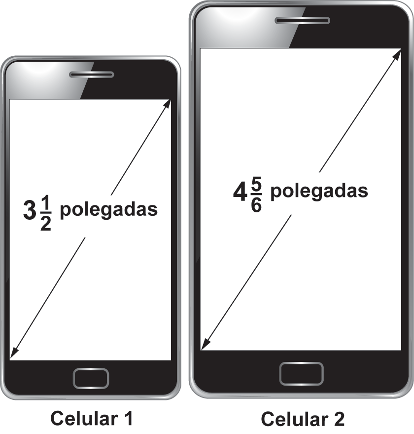

>Disponível em: www.tecmundo.com.br. Acesso em: 5 nov. 2014 (adaptado).

A diferença de tamanho, em valor absoluto, entre as medidas, em polegada, das telas do celular 2 e do celular 1, representada apenas com uma casa decimal, é

- **A** 0,1.
- **B** 0,5.
- **C** 1,0.
- **D** 1,3.
- **E** 1,8.

# QUESTÃO 143

Uma imobiliária iniciou uma campanha de divulgação para promover a venda de apartamentos que podem ser pagos em 100 parcelas mensais. O valor da primeira delas é fixado no momento da compra, com o pagamento dessa primeira parcela. A partir da segunda parcela, o valor é determinado pela aplicação de um acréscimo percentual fixo ao valor da parcela anterior. Como atrativo, a imobiliária fará o pagamento de todas as parcelas correspondentes ao mês de aniversário do comprador.

Um cliente, que faz aniversário no mês de maio, decidiu comprar um desses apartamentos por meio do financiamento oferecido pela imobiliária, e pretende escolher o mês mais adequado para realizar essa compra, de modo que o valor total dos pagamentos seja o menor possível.

Qual é o mês que esse cliente deveria escolher para realizar a compra do apartamento?

- **A** Fevereiro.
- **B** Abril.
- **C** Maio.
- **D** Junho.
- **E** Agosto.

# QUESTÃO 144

Um sistema de polias circulares e correias é um dos mecanismos responsáveis pela transmissão de movimento em máquinas rotativas. O manual de um motor traz uma figura representando um sistema composto por duas polias e uma correia de transmissão, tensionada e perfeitamente ajustada sobre as polias, de modo a não apresentar folgas nos contatos com as polias. Considere que as partes dessa correia que não ficam em contato com as polias são representadas por segmentos de reta tangentes às polias.

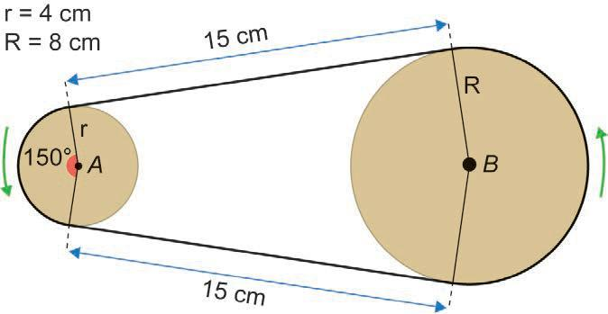

Para substituição dessa correia, é necessária a especificação de seu comprimento.
Considere 3 como valor aproximado para $\pi$.

A medida do comprimento dessa correia, em centímetro, é

- **A** 54.
- **B** 60.
- **C** 66.
- **D** 68.
- **E** 72.

# QUESTÃO 145

A prefeitura de uma cidade planeja construir três postos de saúde. Esses postos devem ser construídos em locais equidistantes entre si e de forma que as distâncias desses três postos ao hospital dessa cidade sejam iguais. Foram conseguidos três locais para a construção dos postos de saúde que apresentam as características desejadas, e que distam 10 km entre si, conforme o esquema, no qual o ponto $H$ representa o local onde está construído o hospital; os pontos $P_1$, $P_2$ e $P_3$, os postos de saúde; e esses quatro pontos estão em um mesmo plano.

A distância, em quilômetro, entre o hospital e cada um dos postos de saúde, é um valor entre

- **A** 2 e 3.
- **B** 4 e 5.
- **C** 5 e 6.
- **D** 7 e 8.
- **E** 8 e 9.

# QUESTÃO 146

Projetistas de uma fábrica de amortecedores realizaram uma série de experimentos que produziram oscilações semelhantes ao comportamento do gráfico de uma senoide, para qualquer tipo de estrada. Cada experimento teve duração de 20 minutos, sendo os 9 primeiros minutos em superfície que simula uma rodovia asfaltada, e os 11 minutos restantes em superfície que simula uma estrada de chão.

Para os amortecedores serem aprovados no experimento, exige-se que as amplitudes das ondas oscilatórias, em cada tipo de superfície, sejam constantes e, ainda, que a amplitude da oscilação do amortecedor no asfalto seja menor do que sua amplitude da oscilação na estrada de chão.

O tipo de gráfico que descreve o comportamento oscilatório de um amortecedor aprovado nesse experimento é

- **A** 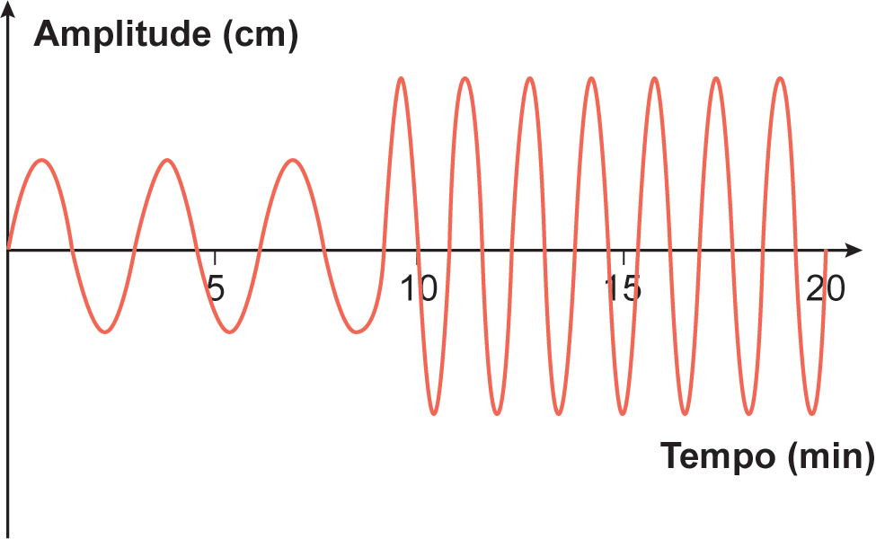
- **B** 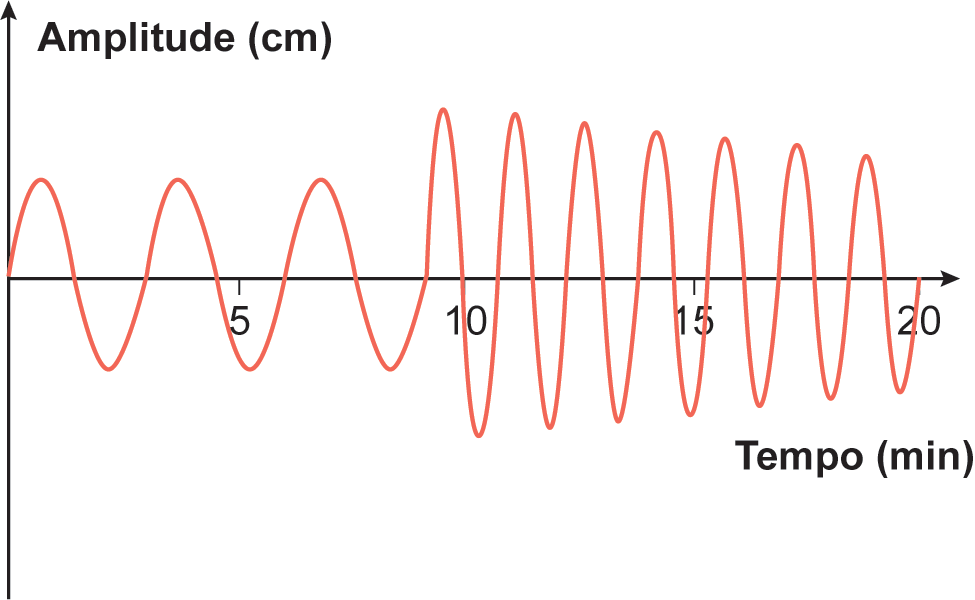
- **C** 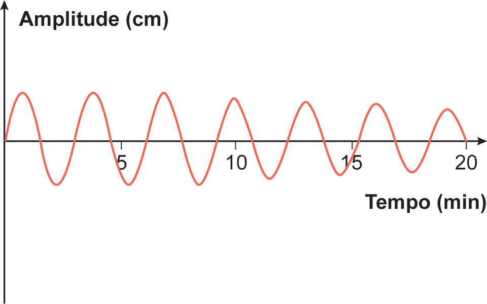
- **D** 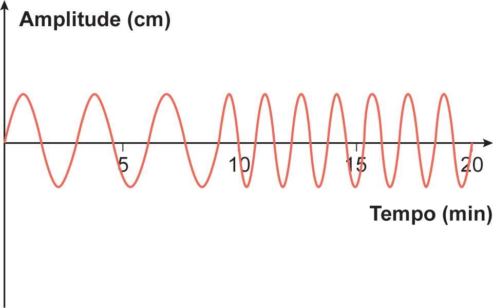
- **E** 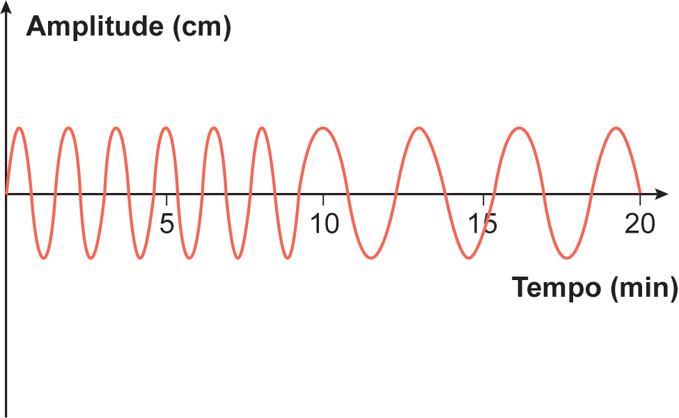

# QUESTÃO 147

Um jardineiro dispõe de \(k\) metros lineares de cerca baixa para fazer um jardim ornamental. O jardim, delimitado por essa cerca, deve ter a forma de um triângulo equilátero, um quadrado ou um hexágono regular. A escolha será pela forma que resulte na maior área.

O jardineiro escolherá a forma de

- **A** hexágono regular, pois a área do jardim, em metro quadrado, será \(\frac{k^2\sqrt{3}}{24}\).
- **B** hexágono regular, pois a área do jardim, em metro quadrado, será \(\frac{3k^2\sqrt{3}}{2}\).
- **C** quadrado, pois a área do jardim, em metro quadrado, será \(\frac{k^2}{16}\).
- **D** triângulo equilátero, pois a área do jardim, em metro quadrado, será \(\frac{k^2\sqrt{3}}{36}\).
- **E** triângulo equilátero, pois a área do jardim, em metro quadrado, será \(\frac{k^2\sqrt{3}}{4}\).

# QUESTÃO 148

Um aeroporto disponibiliza o serviço de transporte gratuito entre seus dois terminais utilizando os ônibus A e B, que partem simultaneamente, de hora em hora, de terminais diferentes. A distância entre os terminais é de 9000 metros, e o percurso total dos ônibus, de um terminal ao outro, é monitorado por um sistema de cinco câmeras que cobrem diferentes partes do trecho, conforme o esquema.

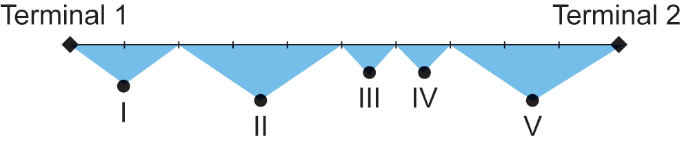

O alcance de cada uma das cinco câmeras é:

- câmera I: \(\frac{1}{5}\) do percurso;
- câmera II: \(\frac{3}{10}\) do percurso;
- câmera III: \(\frac{1}{10}\) do percurso;
- câmera IV: \(\frac{1}{10}\) do percurso;
- câmera V: \(\frac{3}{10}\) do percurso.

Em determinado horário, o ônibus A parte do terminal 1 e realiza o percurso total com velocidade constante de 250 m/min; enquanto o ônibus B, que parte do terminal 2, realiza o percurso total com velocidade constante de 150 m/min.

Qual câmera registra o momento em que os ônibus A e B se encontram?

- **A** I
- **B** II
- **C** III
- **D** IV
- **E** V

# QUESTÃO 149

A criptografia refere-se à construção e análise de protocolos que impedem terceiros de lerem mensagens privadas. Júlio César, imperador romano, utilizava um código para proteger as mensagens enviadas a seus generais. Assim, se a mensagem caísse em mãos inimigas, a informação não poderia ser compreendida. Nesse código, cada letra do alfabeto era substituída pela letra três posições à frente, ou seja, o “A” era substituído pelo “D”, o “B” pelo “E”, o “C” pelo “F”, e assim sucessivamente.

 IMAGEM ERRADA

>Disponível em: www.codifica.ibict.br. Acesso em: 15 out. 2019.

Qualquer código que tenha um padrão de substituição de letras como o descrito é considerado uma Cifra de César ou um Código de César. Note que, para decifrar uma Cifra de César, basta descobrir por qual letra o “A” foi substituído, pois isso define todas as demais substituições a serem feitas.

Uma mensagem, em um alfabeto de 26 letras, foi codificada usando uma Cifra de César. Considere a probabilidade de se descobrir, aleatoriamente, o padrão utilizado nessa codificação, e que uma tentativa frustrada deverá ser eliminada nas tentativas seguintes.

A probabilidade de se descobrir o padrão dessa Cifra de César apenas na terceira tentativa é dada por

- **A** $\frac{1}{25} + \frac{1}{25} + \frac{1}{25}$
- **B** $\frac{24}{25} + \frac{23}{24} + \frac{1}{23}$
- **C** $\frac{1}{25} \times \frac{1}{24} \times \frac{1}{23}$
- **D** $\frac{24}{25} \times \frac{23}{25} \times \frac{1}{25}$
- **E** $\frac{24}{25} \times \frac{23}{24} \times \frac{1}{23}$

# QUESTÃO 150

Em uma região com grande incidência de terremotos, observou-se que dois terremotos ocorridos apresentaram magnitudes $M_1$ e $M_2$, medidos segundo a escala Richter, e liberaram energias iguais a $E_1$ e $E_2$, respectivamente. Entre os estudiosos do assunto, é conhecida uma expressão algébrica relacionando esses valores dada por

$$M_2 - M_1 = \frac{2}{3} \log \left( \frac{E_2}{E_1} \right)$$

Estudos mais abrangentes observaram que o primeiro terremoto apresentou a magnitude $M_1 = 6,9$ e a energia liberada foi um décimo da observada no segundo terremoto.

O valor aproximado da magnitude $M_2$ do segundo terremoto, expresso com uma casa decimal, é igual a

- **A** 5,4.
- **B** 6,2.
- **C** 7,6.
- **D** 8,2.
- **E** 8,4.

# QUESTÃO 151

Uma indústria faz uma parceria com uma distribuidora de sucos para lançar no mercado dois tipos de embalagens. Para a fabricação dessas embalagens, a indústria dispõe de folhas de alumínio retangulares, de dimensões 10 cm por 20 cm. Cada uma dessas folhas é utilizada para formar a superfície lateral da embalagem, em formato de cilindro circular reto, que posteriormente recebe fundo e tampa circulares. A figura ilustra, dependendo de qual das duas extensões será utilizada como altura, as duas opções para formar a possível embalagem.

Dentre essas duas embalagens, a de maior capacidade apresentará volume, em centímetro cúbico, igual a

- **A** $4\,000\ \pi$
- **B** $2\,000\ \pi$
- **C** $\dfrac{4\,000}{\pi}$
- **D** $\dfrac{1\,000}{\pi}$
- **E** $\dfrac{500}{\pi}$

# QUESTÃO 152

As receitas anuais obtidas por uma indústria no período de 2014 a 2021, em milhão de reais, foram registradas, por pontos, em um gráfico. Nele, também está representada a reta que descreve a tendência de evolução das receitas. Essa reta pode ser utilizada para estimar as receitas dos anos seguintes.

A estimativa da receita, em milhão de reais, dessa indústria, para o ano de 2026, obtida a partir dessa reta de tendência, é

- **A** 7.
- **B** 8.
- **C** 9.
- **D** 10.
- **E** 11.

# QUESTÃO 153

Um tanque, em formato de paralelepípedo reto retângulo, tem em seu interior dois anteparos verticais, fixados na sua base e em duas paredes opostas, sendo perpendiculares a elas, conforme a figura.

Esses anteparos, de espessuras desprezíveis, estão instalados de maneira a dividir a base do tanque em três retângulos congruentes, tendo suas alturas iguais à metade e a um quarto da altura do tanque. O tanque é abastecido por uma entrada situada no teto, através de um duto que despeja água a uma vazão constante, sendo necessárias 12 horas para finalizar o seu enchimento.

O gráfico que descreve, em cada instante, a maior altura de coluna de água, dentre aquelas que vão sendo formadas ao longo do enchimento do tanque, é

- **A** 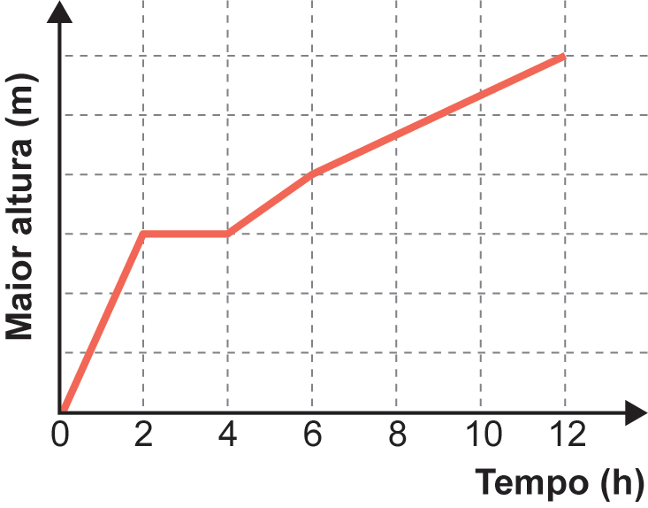
- **B** 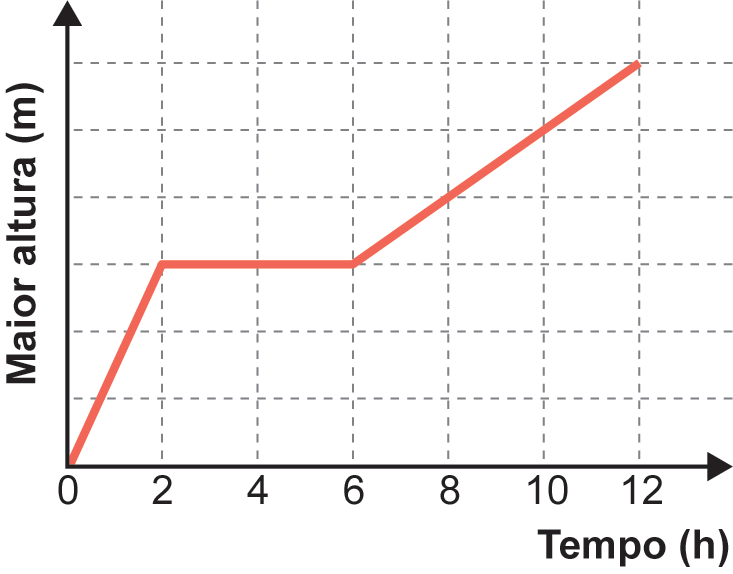
- **C** 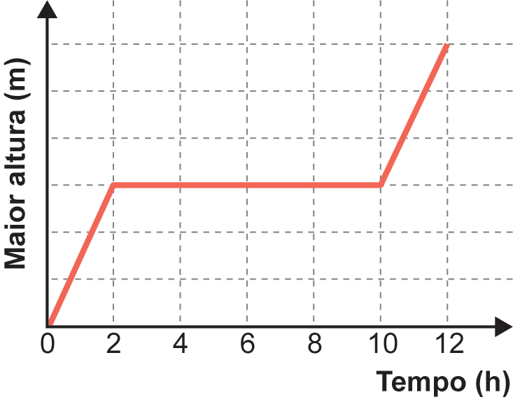
- **D** 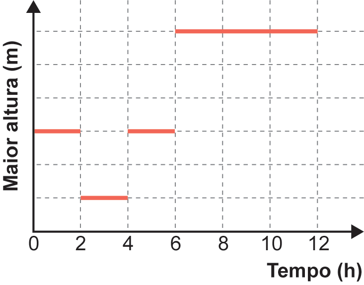
- **E** 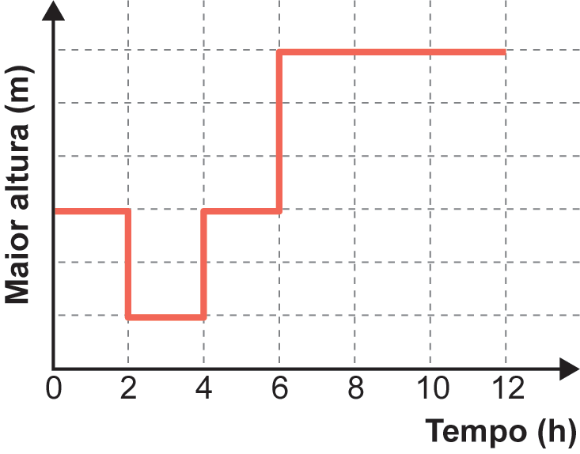

# QUESTÃO 154

Contratos de vários serviços disponíveis na internet apresentam uma quantidade excessiva de informações. Isso faz com que o tempo necessário para a leitura desses contratos possa ser longo.

O quadro apresenta uma amostra do tempo considerado necessário para a leitura completa do contrato de alguns serviços digitais.

| Tipo de serviço | Tempo necessário para a leitura completa do contrato (em minuto) |
| :---: | :---: |
| A | 36 |
| B | 17 |
| C | 27 |
| D | 13 |
| E | 13 |
| F | 13 |

>ROMERO, L. Não li e concordo. **Superinteressante**, n. 307, ago. 2012 (adaptado).

O tempo médio, em minuto, necessário para a leitura completa de um contrato de serviço dentre os listados no quadro é, com uma casa decimal, aproximadamente,

- **A** 13,0.
- **B** 15,0.
- **C** 19,8.
- **D** 20,0.
- **E** 23,3.

# QUESTÃO 155

Um proprietário pretende instalar um sensor de presença para a proteção de seu imóvel. O sensor deverá detectar movimentos de objetos e pessoas numa determinada região plana. A figura ilustra a vista superior da área de cobertura (setor circular em azul) de um sensor colocado no ponto S. Essa área depende da medida do ângulo $\alpha$, em grau, e do raio $R$, em metro.

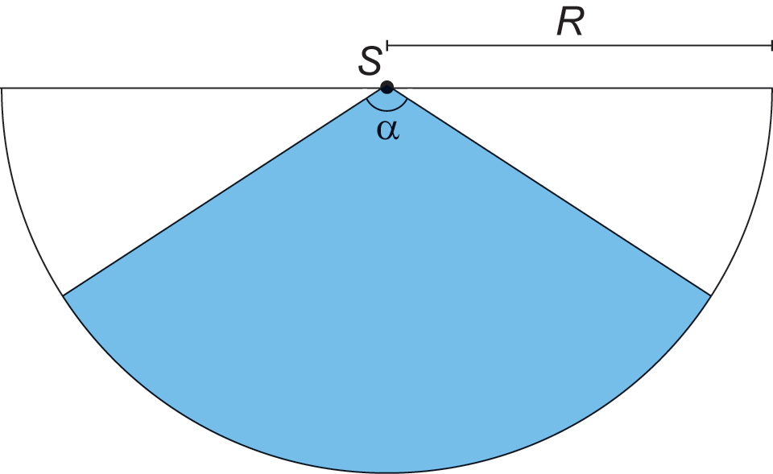

Ao aumentar o ângulo $\alpha$ ou o raio $R$ aumenta-se a área de cobertura do sensor. Entretanto, quanto maior essa área, maior o preço do sensor.

Para esse fim, há cinco tipos de sensores disponíveis no mercado, cada um com as seguintes características:

- tipo I: $\alpha = 15^\circ$ e $R = 20\text{ m}$;
- tipo II: $\alpha = 30^\circ$ e $R = 22\text{ m}$;
- tipo III: $\alpha = 40^\circ$ e $R = 12\text{ m}$;
- tipo IV: $\alpha = 60^\circ$ e $R = 16\text{ m}$;
- tipo V: $\alpha = 90^\circ$ e $R = 10\text{ m}$.

Esse proprietário pretende adquirir um desses sensores que seja capaz de cobrir, no mínimo, uma área de medida $70\text{ m}^2$, com o menor preço possível.

Use 3 como valor aproximado para $\pi$.

O proprietário do imóvel deverá adquirir o sensor do tipo

- **A** I.
- **B** II.
- **C** III.
- **D** IV.
- **E** V.

# QUESTÃO 156

O uso de aplicativos de transporte tem sido uma alternativa à população que busca preços mais competitivos para se locomover, principalmente nas grandes cidades. As formas usadas para determinar o valor cobrado por cada viagem variam de um aplicativo para outro, mas, em geral, o valor $V$ a ser pago, em real, varia em função de:

- tarifa base $F$: valor fixo, em real, cobrado no início da viagem;
- tempo $T$: tempo, em minuto, de duração da viagem;
- distância $D$: distância percorrida, em quilômetro.

Um desses aplicativos cobra R$ 2,00 de valor fixo, acrescido de R$ 0,26 por minuto de viagem e de R$ 1,40 por quilômetro rodado.

Nessas condições, a expressão que fornece o valor $V$ a ser pago por uma viagem desse aplicativo é

- **A** $2,00F + 0,26T + 1,40D$
- **B** $2,00 + 0,26T + 1,40D$
- **C** $2,00 + 0,26T + D$
- **D** $0,26T + 1,40D$
- **E** $F + T + D$

# QUESTÃO 157

Uma piscina tem capacidade de 2 500 000 litros. Seu sistema de abastecimento foi regulado para ter uma vazão constante de 6 000 litros de água por minuto.

O mesmo sistema foi instalado em uma segunda piscina, com capacidade de 2 750 000 litros, e regulado para ter uma vazão, também constante, capaz de enchê-la em um tempo 20% maior que o gasto para encher a primeira piscina.

A vazão do sistema de abastecimento da segunda piscina, em litro por minuto, é

- **A** 8 250.
- **B** 7 920.
- **C** 6 545.
- **D** 5 500.
- **E** 5 280.

# QUESTÃO 158

Uma tubulação despeja sempre o mesmo volume de água por unidade de tempo em uma caixa-d'água, o que significa dizer que a vazão de água nessa tubulação é constante. Na junção dessa tubulação com a caixa-d'água, está instalada uma membrana de filtragem cujo objetivo é filtrar eventuais impurezas presentes na água, combinado a um bom fluxo de água. O fluxo ($\phi$) de água através da superfície da membrana é diretamente proporcional à vazão de água na tubulação, medida em mililitro por segundo, e inversamente proporcional à área da superfície da membrana, medida em centímetro quadrado.

A unidade de medida adequada para descrever o fluxo ($\phi$) de água que atravessa a superfície da membrana é

- **A** $\text{mL} \cdot \text{s} \cdot \text{cm}^2$
- **B** $\frac{\text{mL}}{\text{s}} \cdot \text{cm}^2$
- **C** $\frac{\text{mL}}{\text{cm}^2 \cdot \text{s}}$
- **D** $\frac{\text{cm}^2 \cdot \text{s}}{\text{mL}}$
- **E** $\frac{\text{cm}^2}{\text{mL} \cdot \text{s}}$

# QUESTÃO 159

Em uma loja de defensivos agrícolas, os preços de alguns produtos foram divulgados em um cartaz.

Sabe-se que 1 litro de defensivo do Tipo A é suficiente para aplicação em 0,5 hectare (ha), enquanto que 1 litro de defensivo do Tipo B é suficiente para aplicação em 0,4 ha. Um agricultor precisa comprar, nessa loja, uma quantidade de litros de defensivo suficiente para aplicar em uma área de 20 ha, além de levar uma máscara para aplicação.

O valor mínimo, em real, a ser gasto pelo agricultor é

- **A** 147,00.
- **B** 150,00.
- **C** 162,50.
- **D** 165,75.
- **E** 168,00.

# QUESTÃO 160

Uma doceira vende e entrega, em seu bairro, porções de 100 g de docinhos de aniversário. Atualmente, a taxa única de entrega é R$ 10,00, e o valor cobrado por uma porção é R$ 25,00. Por uma estratégia de vendas, a partir da próxima semana, a taxa única de entrega será R$ 15,00, e um novo valor será cobrado por uma porção, de maneira que o valor total a ser pago por um cliente na compra de 5 porções permaneça o mesmo.

A partir da próxima semana, qual será o novo valor cobrado, em real, por uma porção?

- **A** 12,50
- **B** 20,00
- **C** 24,00
- **D** 30,00
- **E** 37,50

# QUESTÃO 161

Uma empresa tem 400 funcionários, distribuídos em três setores: administrativo, logística e produção. O gráfico apresenta a distribuição quantitativa desses funcionários, por setor e por faixa etária.

![Gráfico de barras empilhadas intitulado "Quantidade de funcionários" no eixo vertical, com marcações em 0, 80, 120 e 200, e "Setor" no eixo horizontal, com as categorias Administrativo, Logística e Produção. A barra de Administrativo tem 20% em vermelho, 30% em amarelo e 50% em azul. A barra de Logística tem 25% em vermelho, 40% em amarelo e 35% em azul. A barra de Produção tem 40% em vermelho, 35% em amarelo e 25% em azul. A legenda indica: quadrado azul "A partir de 45 anos", quadrado amarelo "Entre 25 e 45 anos" e quadrado vermelho "Até 25 anos".](pg25img0_x0_88_y0_176_x1_457_y1_510.png)

Uma viagem de férias será sorteada entre esses funcionários, de forma que todos terão igual probabilidade de serem sorteados.

A maior probabilidade é que o funcionário sorteado esteja na faixa etária

- **A** entre 25 e 45 anos, pois é a faixa etária com maior quantidade de funcionários.
- **B** entre 25 e 45 anos, pois é a única faixa etária cujas porcentagens são maiores do que as porcentagens mínimas de cada setor.
- **C** até 25 anos, pois é a única faixa etária cujos percentuais associados aos setores aumentam com o aumento da quantidade de funcionários por setor.
- **D** até 25 anos, pois é a faixa etária que apresenta maior quantidade de funcionários no setor de produção, que é o setor que emprega metade dos funcionários dessa empresa.
- **E** a partir de 45 anos, pois a soma das porcentagens associadas a essa faixa etária é 110%, que é maior do que as respectivas somas associadas às outras faixas etárias, que são 105% e 85%.

# QUESTÃO 162

Em um jogo virtual para celular, um personagem pode percorrer trajetórias retilíneas voando ou se deslocando ao longo de paredes. Considere que o personagem descreve a trajetória $ABCDEF$, em que os pontos $A$, $D$ e $E$ estão em um plano paralelo ao que contém os pontos $B$ e $C$, sendo esses dois planos ortogonais ao plano da base que contém o ponto $F$, conforme a figura.

A projeção ortogonal, sobre o plano da base, da trajetória $ABCDEF$ descrita pelo personagem é

- **A** 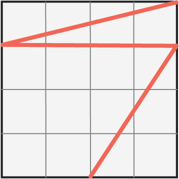
- **B** 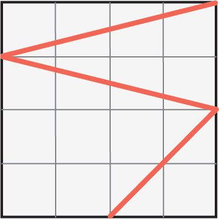
- **C** 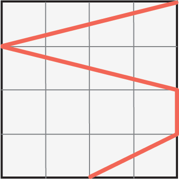
- **D** 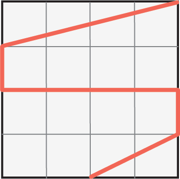
- **E** 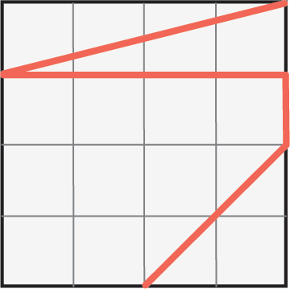

# QUESTÃO 163

O tamanho mínimo que a visão humana é capaz de visualizar sem o uso de equipamento auxiliar é equivalente a 100 micrômetros (1 micrômetro = $10^{-3}$ milímetros). Uma estudante pretende visualizar e analisar hemácias do sangue humano, que medem 0,007 mm de diâmetro. Ela adquiriu um microscópio óptico que tem uma lente ocular que amplia em 10 vezes a imagem do objeto em observação, e um conjunto de lentes objetivas com estas capacidades de ampliação:

- lente I: 2 vezes;
- lente II: 10 vezes;
- lente III: 15 vezes;
- lente IV: 1,1 vez;
- lente V: 1,4 vez.

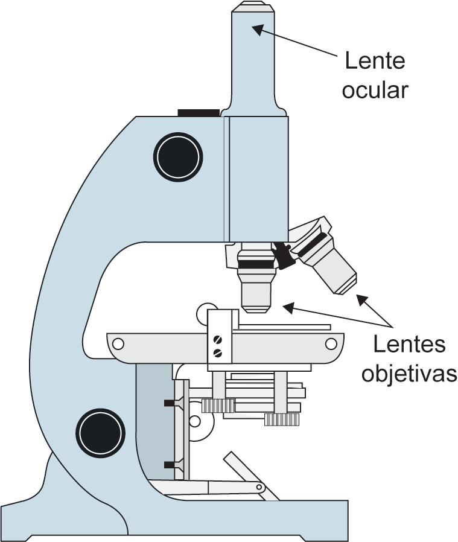

O funcionamento desse microscópio permite o uso da lente ocular sozinha ou a combinação dela com uma de suas lentes objetivas, proporcionando, nesse caso, um aumento de sua capacidade de ampliação final, que é dada pelo produto entre as capacidades de ampliação da ocular e da objetiva.

Essa estudante pretende selecionar a lente objetiva de menor capacidade de ampliação que permita, na combinação com a ocular, visualizar hemácias do sangue humano.

A lente objetiva a ser selecionada pela estudante é a

- **A** I.
- **B** II.
- **C** III.
- **D** IV.
- **E** V.

# QUESTÃO 164

Ao calcular a média de suas notas em 4 provas, um estudante dividiu, por engano, a soma das notas por 5. Com isso, a média obtida foi 1 unidade menor do que deveria ser, caso fosse calculada corretamente.

O valor correto da média das notas desse estudante é

- **A** 4.
- **B** 5.
- **C** 6.
- **D** 19.
- **E** 21.

# QUESTÃO 165

Para abrir a porta de uma empresa, cada funcionário deve cadastrar uma senha utilizando um teclado alfanumérico como o representado na figura.

Por exemplo: a tecla que contém o número 2 traz as letras correlacionadas A, B e C. Cada toque nessa tecla mostra, sequencialmente, os seguintes caracteres: 2, A, B e C. Para os próximos toques, essa sequência se repete. As demais teclas funcionam da mesma maneira.

As senhas a serem cadastradas pelos funcionários devem conter 5 caracteres, sendo 2 algarismos distintos seguidos de 3 letras diferentes, nessa ordem. Um funcionário irá cadastrar a sua primeira senha, podendo escolher entre as teclas que apresentam os números 1, 2, 5, 7 e 0 e as respectivas letras correlacionadas, quando houver.

O número de possibilidades diferentes que esse funcionário tem para cadastrar sua senha é

- **A** 11 520.
- **B** 14 400.
- **C** 18 000.
- **D** 312 000.
- **E** 390 000.

# QUESTÃO 166

Um artesão utiliza dois tipos de componentes, X e Y, nos enfeites que produz. Ele sempre compra todos os componentes em uma mesma loja. O quadro apresenta os preços dos dois tipos de componentes nas lojas I e II.

| Lojas | Preços dos componentes (R$) | |
| :---: | :---: | :---: |
| | **X** | **Y** |
| I | 3,00 | 1,00 |
| II | 2,00 | 4,00 |

Ele confeccionará enfeites formados por duas unidades do componente X e uma unidade do componente Y e efetuará a compra na loja que oferecer o menor valor total para a confecção de um enfeite.

O artesão efetuará a compra na loja

- **A** I, pois o valor é R$ 7,00.
- **B** I, pois o valor é R$ 4,00.
- **C** II, pois o valor é R$ 6,00.
- **D** I, pois anuncia o componente com o menor preço.
- **E** II, pois o componente X, que é o mais utilizado, tem menor preço.

# QUESTÃO 167

João e Felipe participaram, na escola, de uma maratona de matemática na qual, durante uma semana, resolveram 200 questões cada. Nessa maratona, a porcentagem \(P\) de acertos de cada participante é convertida em um conceito:

- insatisfatório: se \(0 \le P < 50\);
- regular: se \(50 \le P < 60\);
- bom: se \(60 \le P < 75\);
- muito bom: se \(75 \le P < 90\);
- excelente: se \(90 \le P \le 100\).

João acertou 75% das questões da maratona e Felipe acertou 30% a menos que a quantidade de questões que João acertou.

Os conceitos de João e Felipe foram, respectivamente,

- **A** muito bom e bom.
- **B** muito bom e regular.
- **C** muito bom e insatisfatório.
- **D** bom e regular.
- **E** bom e insatisfatório.

# QUESTÃO 168

Três grandezas (I, II e III) se relacionam entre si. Os gráficos a seguir, formados por segmentos de reta, descrevem as relações de dependência existentes entre as grandezas I e II, e entre as grandezas II e III.

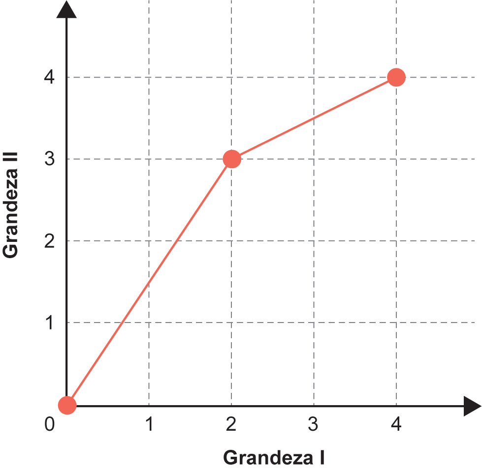

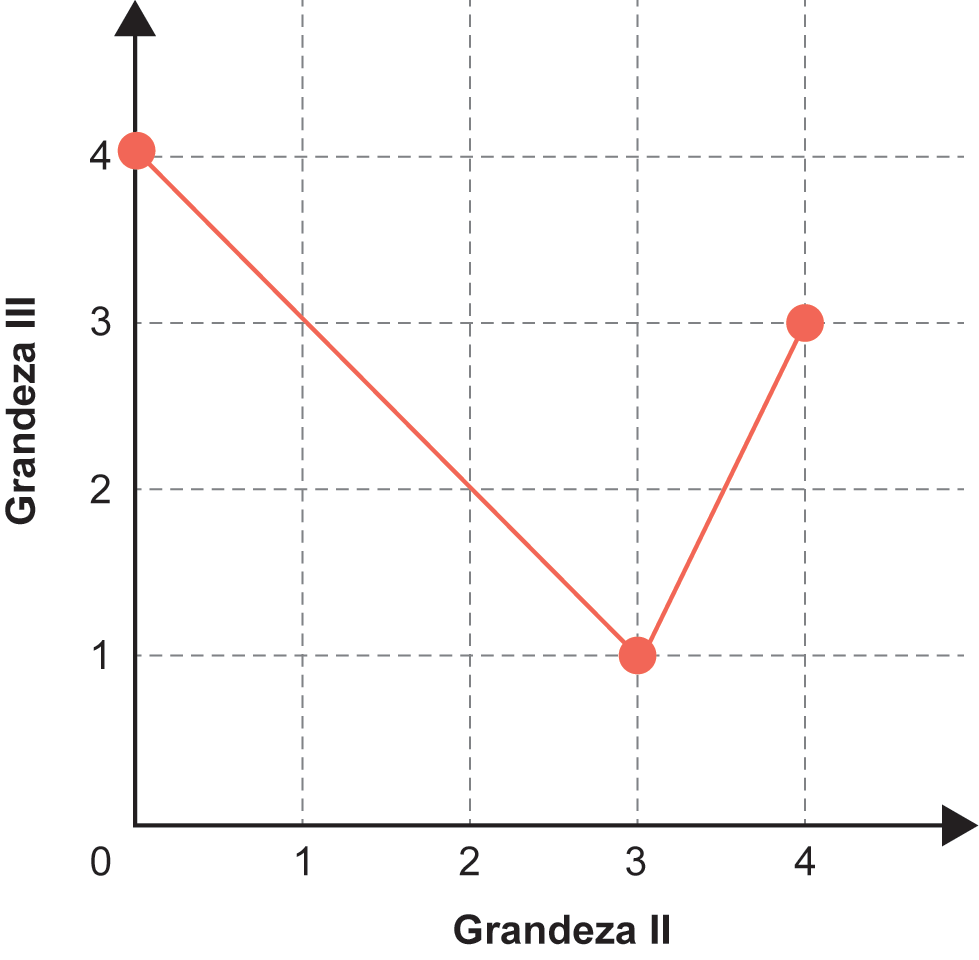

O valor máximo assumido pela grandeza III, quando a grandeza I varia de 1 a 3, é

- **A** 1,0.
- **B** 2,5.
- **C** 3,0.
- **D** 3,5.
- **E** 4,0.

# QUESTÃO 169

Uma criança, utilizando um aplicativo, escreveu uma mensagem para enviar a um amigo. Essa mensagem foi escrita seguindo estas etapas:

| Etapas | Visor de escrita |
| :--- | :--- |
| 1ª etapa: inseri três figuras do tipo 😊 no visor de escrita da mensagem; | 😊😊😊 |
| 2ª etapa: copiou o que havia inserido anteriormente e colou (inseriu o que havia copiado) ao lado; | 😊😊😊😊😊😊 |
| 3ª etapa: copiou o que tinha no visor na 2ª etapa e colou ao lado. | 😊😊😊😊😊😊😊😊😊😊😊😊 |

A criança seguiu copiando e colando, em cada etapa, o que tinha no visor na etapa imediatamente anterior, até concluir a 20ª etapa. Em seguida, enviou a mensagem.

Qual foi o total de figuras contidas na mensagem enviada?

- **A** $3 \times 2^{19}$
- **B** $3 \times 2^{20}$
- **C** $3 \times 2^{21}$
- **D** $3 \times 2^{20} - 1$
- **E** $3 \times 2^{20} - 3$

# QUESTÃO 170

Uma casa de shows terá um evento cujo custo total de produção é de R$ 34 350,00, sendo que comporta 500 pessoas. O preço do ingresso será de R$ 130,00 e, normalmente, 60% das pessoas adquirem meia-entrada, pagando R$ 65,00 pelo ingresso. Além do faturamento proveniente da venda de ingressos, a casa de shows vende, com 60% de lucro, bebidas e petiscos ao público no dia do evento.

Após ter vendido todos os 500 ingressos, constatou-se que a quantidade de meias-entradas vendidas superou em 50% o que estava previsto, impactando o faturamento estimado com a venda de ingressos.

No dia do evento, decidiu-se manter o percentual de 60% de lucro sobre as bebidas e petiscos, pois todo o público que comprou ingresso compareceu ao show. Com isso, espera-se ter lucro de R$ 17 000,00 nesse evento.

Para que se alcance o lucro esperado, o gasto médio por pessoa com bebidas e petiscos, em real, deverá ser de

- **A** 19,50.
- **B** 28,80.
- **C** 34,00.
- **D** 52,00.
- **E** 68,70.

# QUESTÃO 171

Para obter um sólido de revolução (rotação de 360º em torno de um eixo fixo), uma professora realizou as seguintes etapas:

- recortou o trapézio retângulo PQRS de um material rígido;
- afixou o lado PS do trapézio em uma vareta fixa retilínea (eixo de rotação);
- girou o trapézio 360º em torno da vareta e obteve um sólido de revolução.

Observe a figura que apresenta o trapézio afixado na vareta e o sentido de giro.

O sólido obtido foi um(a)

- **A** cone.
- **B** cilindro.
- **C** pirâmide.
- **D** tronco de cone.
- **E** tronco de pirâmide.

# QUESTÃO 172

>O estádio do Maracanã passou por algumas modificações estruturais para a realização da Copa do Mundo de 2014, como, por exemplo, as dimensões do campo retangular. Para se adaptar aos padrões da Fifa, as dimensões do campo foram reduzidas de 110 m × 75 m para 105 m × 68 m.
>
>Disponível em: http://virgula.uol.com.br.
Acesso em: 14 ago. 2013 (adaptado).

Em quantos metros quadrados a área do campo do Maracanã foi reduzida?

- **A** 24
- **B** 35
- **C** 555
- **D** 1110
- **E** 1145

# QUESTÃO 173

Uma sala com piso no formato retangular, com lados de medidas 3 m e 6 m, será dividida em dois ambientes. Para isso, serão utilizadas colunas em formato cilíndrico, dispostas perpendicularmente ao piso e representadas na figura pelos círculos de cor azul. Os centros desses círculos estarão sobre uma reta paralela aos lados de menor medida do piso da sala. Os vãos entre duas colunas e entre uma coluna e a parede não poderão ser superiores a 15 cm.

Para efetuar a compra dessas colunas, foram feitos orçamentos com base em dados fornecidos por cinco lojas.

| Loja | Raio (cm) | Preço por unidade (R$) |
|---|---|---|
| I | 5 | 60 |
| II | 10 | 70 |
| III | 12 | 75 |
| IV | 15 | 90 |
| V | 20 | 120 |

A compra será realizada na loja cujo orçamento resulte no menor valor total possível.

A compra será realizada na loja

- **A** I.
- **B** II.
- **C** III.
- **D** IV.
- **E** V.

# QUESTÃO 174

>O arquiteto Renzo Piano exibiu a maquete da nova sede do Museu Whitney de Arte Americana, um prédio assimétrico que tem um vão aberto para a galeria principal, cuja medida da área é 1 672 m².
>
>Considere que a escala da maquete exibida é 1 : 200.
>
> Época, n. 682, jun. 2011 (adaptado).

A medida da área do vão aberto nessa maquete, em centímetro quadrado, é

- **A** 4,18.
- **B** 8,36.
- **C** 41,80.
- **D** 83,60.
- **E** 418,00.

# QUESTÃO 175

O gráfico apresenta o valor total de exportações e o valor total de importações, ao longo de um período, em bilhão de dólares. O saldo da balança comercial brasileira é dado pelo valor total de exportações menos o valor total de importações num mesmo período.

**Valor total de exportações e importações**
■ Importações ■ Exportações

>Fonte: Ministério do Desenvolvimento.
>Disponível em: http://blogs.estadao.com.br.
Acesso em: 20 fev. 2013 (adaptado).

Considere que os saldos da balança comercial brasileira, nos três meses destacados no gráfico, sejam representados por:

- $S_1$: saldo em junho de 2009;
- $S_2$: saldo em janeiro de 2010;
- $S_3$: saldo em junho de 2010.

A ordenação dos saldos $S_1$, $S_2$ e $S_3$, do maior para o menor, é

- **A** $S_1$, $S_3$ e $S_2$.
- **B** $S_2$, $S_1$ e $S_3$.
- **C** $S_2$, $S_3$ e $S_1$.
- **D** $S_3$, $S_1$ e $S_2$.
- **E** $S_3$, $S_2$ e $S_1$.

# QUESTÃO 176

Um instituto de pesquisa constatou que, nos últimos dez anos, o crescimento populacional de uma cidade foi de 135,25%.

Qual é a representação decimal da taxa percentual desse crescimento populacional?

- **A** 13525,0
- **B** 135,25
- **C** 13,525
- **D** 1,3525
- **E** 0,13525

# QUESTÃO 177

Um fazendeiro pretende construir um galinheiro ocupando uma região plana de formato retangular, com lados de comprimentos \(L\) metro e \(C\) metro. Os lados serão cercados por telas de tipos diferentes. Nos lados de comprimento \(L\) metro, será utilizada uma tela cujo metro linear custa R$ 20,00, enquanto, nos outros dois lados, uma que custa R$ 15,00. O fazendeiro quer gastar, no máximo, R$ 6.000,00 na compra de toda a tela necessária para o galinheiro, e deseja que o galinheiro tenha a maior área possível.

Qual será a medida, em metro, do maior lado do galinheiro?

- **A** 85
- **B** 100
- **C** 175
- **D** 200
- **E** 350

# QUESTÃO 178

Uma professora de matemática utiliza em suas aulas uma “máquina caça-números” para verificar os conhecimentos de seus estudantes sobre representações de números racionais. Essa máquina tem um visor dividido em seis compartimentos e, na lateral, uma alavanca. Cada estudante puxa a alavanca e espera que os compartimentos parem de girar. A partir daí, precisa responder para a professora em quais posições se encontram os números que representam a mesma quantidade.

Um estudante puxou a alavanca, aguardou que os compartimentos parassem de girar e observou os números apresentados no visor. A configuração da máquina naquele instante está apresentada na imagem.

Esse estudante respondeu corretamente à pergunta da professora.

As posições indicadas pelo estudante foram

- **A** I, II e IV.
- **B** II, IV e V.
- **C** II, III e V.
- **D** III, V e VI.
- **E** III, IV e VI.

# QUESTÃO 179

Uma caneca com água fervendo é retirada de um forno de micro-ondas. A temperatura \(T\), em grau Celsius, da caneca, em função do tempo \(t\), em minuto, pode ser modelada pela função \(T(t) = a + 80 \cdot b^t\), representada no gráfico a seguir.

Os valores das constantes \(a\) e \(b\) são

- **A** \(a = 20\); \(b = \log(0,5)\)
- **B** \(a = 100\); \(b = 0,5\)
- **C** \(a = 20\); \(b = (0,5)^{\frac{1}{10}}\)
- **D** \(a = 20\); \(b = \frac{(40)^{\frac{1}{10}}}{80}\)
- **E** \(a = 20\); \(b = 40\)

# QUESTÃO 180

Em uma empresa é comercializado um produto em embalagens em formato de cilindro circular reto, com raio medindo 3 cm, e altura medindo 15 cm. Essa empresa planeja comercializar o mesmo produto em embalagens em formato de cubo, com capacidade igual a 80% da capacidade da embalagem cilíndrica utilizada atualmente.

Use 3 como valor aproximado para \(\pi\).

A medida da aresta da nova embalagem, em centímetro, deve ser

- **A** 6
- **B** 18
- **C** \(6\sqrt{6}\)
- **D** \(6\sqrt[3]{6}\)
- **E** \(3\sqrt[3]{12}\)

